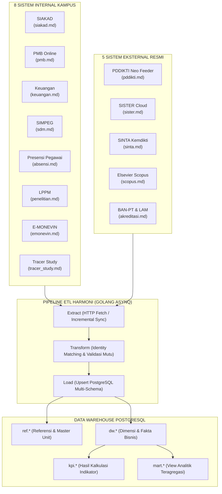

# KATALOG & INDEKS SPESIFIKASI KEBUTUHAN API HARMONI
## University Intelligence Dashboard — Universitas Hamzanwadi

> Dokumen ini adalah **panduan gerbang (gateway index)** untuk spesifikasi kebutuhan API dari **8 sistem internal** dan **5 sistem eksternal** yang terhubung ke University Intelligence Dashboard HARMONI.
> Setiap sistem memiliki berkas spesifikasi teknis mandiri yang mencakup parameter endpoint, skema autentikasi, dan **contoh respons JSON riil**.

---

## 1. Daftar Dokumen Spesifikasi API Per Aplikasi

### A. Sistem Internal Kampus (Hamzanwadi)

| No | File Spesifikasi | Sistem Sumber | Penanggung Jawab / Tim | Cakupan Data Utama | Kritisitas |
|:--:|---|---|---|---|:---:|
| 1 | [`siakad.md`](file:///home/alfian-bhakti/Documents/Projek/harmoni/dashboard-harmoni/kebutuhan_api/siakad.md) | **SIAKAD** | Tim Akademik / Biro BAAK | Data Mahasiswa, Status Semester, Kurikulum, KHS, Kelulusan, Beban Mengajar Dosen | **Kritis** |
| 2 | [`pmb.md`](file:///home/alfian-bhakti/Documents/Projek/harmoni/dashboard-harmoni/kebutuhan_api/pmb.md) | **PMB Online** | Panitia PMB / BAAK | Pendaftar, Jalur Seleksi, Nilai Ujian, Registrasi Ulang, Kuota & Daya Tampung | **Tinggi** |
| 3 | [`keuangan.md`](file:///home/alfian-bhakti/Documents/Projek/harmoni/dashboard-harmoni/kebutuhan_api/keuangan.md) | **Sistem Keuangan** | Biro Keuangan (BAUK) | Pembayaran SPP/UKT Mahasiswa, Anggaran & Realisasi Belanja Unit / Fakultas | **Kritis** |
| 4 | [`sdm.md`](file:///home/alfian-bhakti/Documents/Projek/harmoni/dashboard-harmoni/kebutuhan_api/sdm.md) *(alias `simpeg.md`)* | **SIMPEG** | Bagian Kepegawaian (BSDM) | Master Dosen & Tendik, Riwayat Jabatan Fungsional, Kepangkatan, Pendidikan Terakhir | **Kritis** |
| 5 | [`absensi.md`](file:///home/alfian-bhakti/Documents/Projek/harmoni/dashboard-harmoni/kebutuhan_api/absensi.md) | **Presensi Pegawai** | BSDM / Tim IT Presensi | Log Kehadiran Harian, Verifikasi SSO Subject ID (`sub` JWT Keycloak) | **Tinggi** |
| 6 | [`penelitian.md`](file:///home/alfian-bhakti/Documents/Projek/harmoni/dashboard-harmoni/kebutuhan_api/penelitian.md) *(alias `lppm.md`)* | **LPPM** | Lembaga Penelitian & Pengabdian | Hibah Penelitian, Pengabdian Masyarakat (PKM), Publikasi Jurnal, Paten / HKI | **Kritis** |
| 7 | [`emonevin.md`](file:///home/alfian-bhakti/Documents/Projek/harmoni/dashboard-harmoni/kebutuhan_api/emonevin.md) | **E-MONEVIN** | Lembaga Penjaminan Mutu (LPM) | Standar SPMI, Audit Mutu Internal (AMI), Temuan Mayor/Minor, Kinerja Unit | **Kritis** |
| 8 | [`tracer_study.md`](file:///home/alfian-bhakti/Documents/Projek/harmoni/dashboard-harmoni/kebutuhan_api/tracer_study.md) *(alias `alumni.md`)* | **Tracer Study** | UPT Karir & Alumni | Waktu Tunggu Kerja, Keselarasan Bidang Kerja, Besaran Gaji Pertama, Direktori Alumni | **Tinggi** |

---

### B. Sistem & Portal Eksternal Resmi

| No | File Spesifikasi | Sistem Sumber | Penanggung Jawab / Sumber | Cakupan Data Utama | Protokol Integrasi |
|:--:|---|---|---|---|:---:|
| 9 | [`pddikti.md`](file:///home/alfian-bhakti/Documents/Projek/harmoni/dashboard-harmoni/kebutuhan_api/pddikti.md) | **PDDIKTI Neo Feeder** | Kemdiktisaintek / Feeder Lokal | Data Master Mahasiswa, Registrasi, dan Beban Mengajar Resmi Nasional | JSON-RPC over HTTP/HTTPS |
| 10 | [`sister.md`](file:///home/alfian-bhakti/Documents/Projek/harmoni/dashboard-harmoni/kebutuhan_api/sister.md) | **SISTER Cloud** | Kemdiktisaintek | Portofolio Dosen, Sertifikasi Pendidik (Serdos), Riwayat Fungsional Resmi | REST API (Bearer Token) |
| 11 | [`sinta.md`](file:///home/alfian-bhakti/Documents/Projek/harmoni/dashboard-harmoni/kebutuhan_api/sinta.md) | **SINTA v3** | Kemdiktisaintek | SINTA Score 3Yr, Score Overall, Indeksasi Riset Perguruan Tinggi (ID: 472) | REST API (API Key) |
| 12 | [`scopus.md`](file:///home/alfian-bhakti/Documents/Projek/harmoni/dashboard-harmoni/kebutuhan_api/scopus.md) | **Elsevier Scopus & Scholar** | Elsevier Developer Portal / Google | H-Index Scopus, Total Sitasi, Jumlah Dokumen Terindeks Scopus | REST API (Scopus API Key) |
| 13 | [`akreditasi.md`](file:///home/alfian-bhakti/Documents/Projek/harmoni/dashboard-harmoni/kebutuhan_api/akreditasi.md) | **BAN-PT & LAM** | SAPTO BAN-PT, LAMDIK, LAM-PTKes, LAM-INFOKOM | Status Akreditasi Institusi (APT), Akreditasi Prodi (APS), Masa Berlaku SK | REST API & Scraping |

---

## 2. Diagram Alur Data Integrasi

---

## 14. Matriks Pemetaan Identitas Antar-Sistem (Identity Key Matching)

Tabel berikut menunjukkan keterkaitan kunci identitas (*natural keys*) yang digunakan pipeline ETL HARMONI untuk menghubungkan rekaman data dari **8 sistem internal** dan **5 sistem eksternal**:

| Entitas Utama | Kunci Internal Kampus | Kunci Sistem Eksternal Resmi | Skema & Kolom Tujuan HARMONI |
|---|---|---|---|
| **Dosen** | `nidn` (SIMPEG, SIAKAD, LPPM), `nip` (Absensi) | `id_sdm` (SISTER), `sinta_id` (SINTA), `scopus_id` (Scopus) | `dw.dim_pegawai (nidn, nip, sso_subject, sinta_id, scopus_id)` |
| **Karyawan / Tendik** | `nip` (SIMPEG, Absensi) | `sso_id` (Keycloak SSO Hamzanwadi) | `dw.dim_pegawai (nip, sso_subject)` |
| **Mahasiswa** | `nim` (SIAKAD, PMB, Tracer) | `id_registrasi_mahasiswa` (PDDIKTI Neo Feeder) | `dw.dim_mahasiswa (nim, id_registrasi_feeder)` |
| **Program Studi / Unit** | `kode_prodi` (SIAKAD, PMB, Keuangan, E-MONEVIN) | `id_prodi` (Neo Feeder & SISTER UUID) | `ref.unit (kode, id_prodi_feeder)` |
| **Semester** | `semester_kode` (SIAKAD: `20251`) | `id_semester` (PDDIKTI: `20251`) | `ref.semester (kode)` |
| **Mata Kuliah** | `kode_mk` + `kurikulum` (SIAKAD) | `id_mata_kuliah` (Neo Feeder UUID) | `dw.dim_mata_kuliah (kode_mk, kurikulum)` |
| **Publikasi Ilmiah** | `judul_normal` (LPPM) | `doi` (Scopus / SINTA), `issn_isbn` | `dw.fact_publikasi (doi, judul_normal, indeks)` |
| **Akreditasi** | `kode_unit` (E-MONEVIN) | `nomor_sk` (BAN-PT, LAMDIK, LAMINFOKOM) | `dw.fact_akreditasi (unit_id, lembaga, nomor_sk)` |

---

---

## 15. Panduan Pengujian & Checklist Kesiapan Integrasi

Sebelum menghubungkan sistem internal dan eksternal ke pipeline ETL HARMONI di server produksi, tim pengembang dan administrator wajib memverifikasi hal-hal berikut:

- [ ] **Endpoint Internal & Eksternal Aktif:** Seluruh endpoint mengembalikan status HTTP 200 OK atau response error_code 0 (Neo Feeder).
- [ ] **Otentikasi Token Terlindungi:** Kunci API sistem sumber (`SSO_CLIENT_SECRET`, `SISTER_TOKEN`, `ELSEVIER_API_KEY`) tersimpan aman dalam format terenkripsi AES-256-GCM di `etl.sumber_data`.
- [ ] **Filter Inkremental Berfungsi:** Parameter query `updated_since` (Internal API) dan filter `id_periode` (Feeder) hanya menarik data baru/berubah.
- [ ] **Format JSON Sesuai Kontrak:** Struktur nama field, tipe data angka (`float/int`), dan format tanggal ISO 8601 persis mengikuti contoh response pada dokumen ini.
- [ ] **Pencocokan Identitas Berjalan Baik:** Identity matching di `etl.identity_map` mencapai rasio otomatis $\ge 95\%$ untuk NIDN, NIP, dan NIM.
- [ ] **Performa Query Sumber Optimal:** Waktu respons API untuk batch 100 baris tidak melebihi 2 detik.
- [ ] **IP Whitelisting Server:** IP Server HARMONI telah didaftarkan pada whitelist firewall Neo Feeder dan server database internal.

---
*Dokumen spesifikasi kebutuhan API internal dan eksternal HARMONI ini disahkan sebagai standar integrasi resmi data Universitas Hamzanwadi.*
