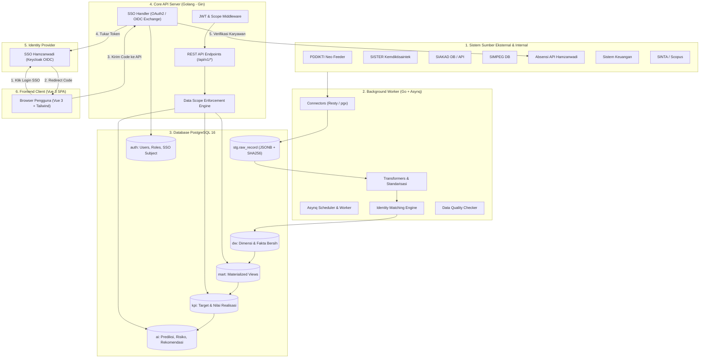
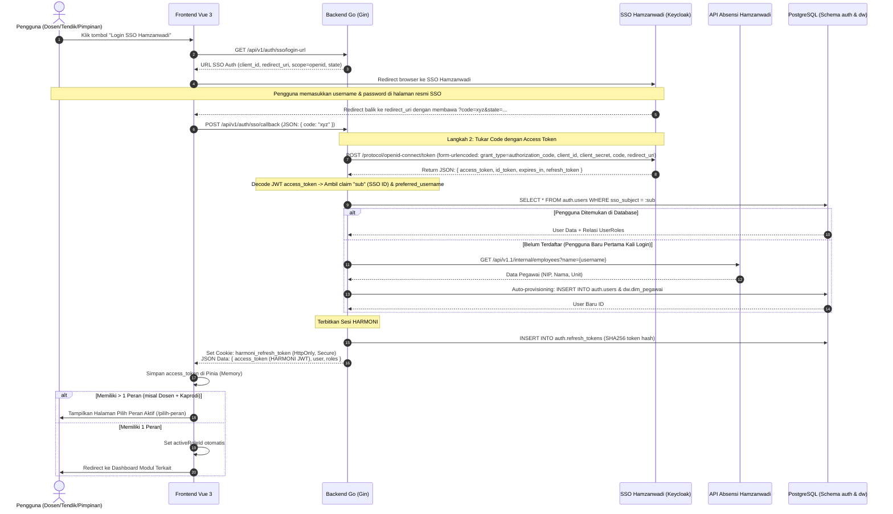
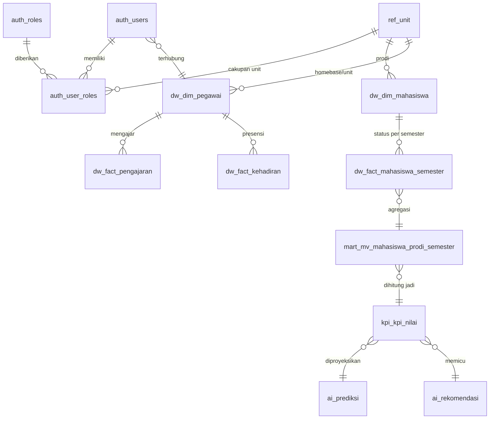
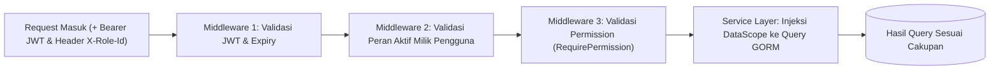
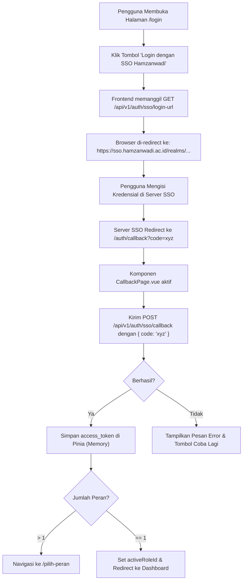
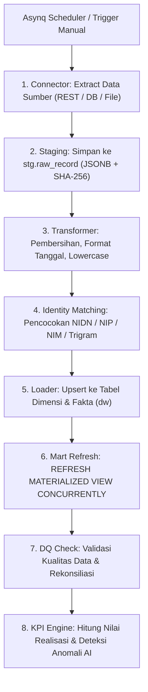

# PERANCANGAN SISTEM HARMONI
## University Intelligence Dashboard — Universitas Hamzanwadi

> Dokumen ini adalah **cetak biru teknis** (technical blueprint) untuk membangun HARMONI.
> Disusun berdasarkan dokumen *Rancangan_Modul_Dashboard_HARMONI.docx*, diagram *Alur Sistem Dashboard Harmoni.jpeg*, dan spesifikasi resmi **SSO Hamzanwadi (OpenID Connect)**.
> **Backend: Go (Golang)** | **Autentikasi: SSO Hamzanwadi (Keycloak OIDC)** | **Frontend: Vue 3 + Bootstrap 5.3 + Bootstrap Icons (Gold Theme)**
> Ditulis agar **junior programmer** atau **AI coding assistant (model murah)** dapat mengerjakannya **langkah demi langkah** tanpa harus mengambil keputusan arsitektur sendiri.

---

## DAFTAR ISI

0. [Cara Menggunakan Dokumen Ini](#0-cara-menggunakan-dokumen-ini)
1. [Ringkasan Sistem](#1-ringkasan-sistem)
2. [Tech Stack (Golang & SSO Hamzanwadi)](#2-tech-stack-golang--sso-hamzanwadi)
3. [Arsitektur Sistem & Alur Autentikasi SSO](#3-arsitektur-sistem--alur-autentikasi-sso)
4. [Struktur Folder Proyek](#4-struktur-folder-proyek)
5. [Struktur Database](#5-struktur-database)
6. [RBAC & Cakupan Data (Data Scope di Golang)](#6-rbac--cakupan-data-data-scope-di-golang)
7. [Desain API Backend & Handler SSO](#7-desain-api-backend--handler-sso)
8. [Peta Menu → Route → Permission → API](#8-peta-menu--route--permission--api)
9. [Desain Frontend & Alur Login SSO](#9-desain-frontend--alur-login-sso)
10. [Integrasi Data & ETL (Go + Asynq Worker)](#10-integrasi-data--etl-go--asynq-worker)
11. [Katalog KPI & Mesin Perhitungan Go](#11-katalog-kpi--mesin-perhitungan-go)
12. [Modul Prediksi & Rekomendasi AI](#12-modul-prediksi--rekomendasi-ai)
13. [Panduan Implementasi Langkah demi Langkah (Golang)](#13-panduan-implementasi-langkah-demi-langkah-golang)
14. [Testing di Golang](#14-testing-di-golang)
15. [Deployment (Docker & Nginx)](#15-deployment-docker--nginx)
16. [Checklist Keamanan](#16-checklist-keamanan)
17. [Lampiran & Contoh Konfigurasi](#17-lampiran--contoh-konfigurasi)

---

## 0. Cara Menggunakan Dokumen Ini

### 0.1 Aturan Emas (WAJIB dipatuhi programmer / AI)

1. **Kerjakan berurutan sesuai Fase di Bagian 13.** Jangan lompat fase. Setiap fase punya *Definition of Done* (DoD) — fase dianggap selesai hanya jika semua checklist DoD tercentang.
2. **Jangan mengganti tech stack yang sudah ditetapkan.** Backend ditulis dalam **Go (Golang)**, autentikasi utama melalui **SSO Hamzanwadi (OIDC)**, database **PostgreSQL 16**, task queue **Asynq + Redis**, dan frontend **Vue 3 + Bootstrap 5.3 + Bootstrap Icons 1.11.0** (sesuai implementasi live di `https://harmonites.adnantech.biz.id/`).
3. **Semua perubahan skema database WAJIB lewat file migrasi SQL (`pressly/goose/v3`).** Jangan pernah mengubah struktur tabel langsung lewat pgAdmin/DBeaver di server produksi.
4. **Setiap endpoint API yang mengembalikan data bisnis WAJIB:**
   - Memakai middleware permission `RequirePermission("...")`.
   - Memfilter query database menggunakan `DataScope` (lihat Bagian 6). **Tidak ada pengecualian.**
5. **Jangan pernah menulis query SQL dengan string concatenation** (`fmt.Sprintf("SELECT ... WHERE id = %s", id)`). Gunakan parameterized query atau method GORM (`db.Where("unit_id IN ?", scope.UnitIDs)`).
6. **HARMONI bersifat read-only terhadap data sumber.** HARMONI tidak mengubah data di SIAKAD/SIMPEG/PDDIKTI/SISTER. Data yang boleh ditulis di HARMONI hanya: konfigurasi peran/user, target KPI, konfigurasi integrasi, status validasi/tindak lanjut rekomendasi AI, skenario simulasi, dan catatan kualitas data.
7. **Nama tabel, kolom, dan kode domain memakai bahasa Indonesia** (mengikuti istilah kampus: `mahasiswa`, `prodi`, `semester`). Nama teknis umum (`id`, `created_at`, `user`, `role`) tetap bahasa Inggris.
8. **Autentikasi menggunakan SSO Hamzanwadi (Keycloak OpenID Connect).** Token SSO diverifikasi, claim `sub` (SSO ID) dicocokkan dengan `auth.users.sso_subject`, lalu backend HARMONI menerbitkan sesi JWT aplikasi internal.
9. **Jika ada aturan bisnis yang belum jelas, catat di `docs/PERTANYAAN.md`.** Jangan menebak rumus KPI atau logika kelulusan tanpa konfirmasi pimpinan.
10. **Jangan pernah meng-commit file `.env`, `SSO_CLIENT_SECRET`, password database, atau data asli civitas akademika ke Git.**

### 0.2 Cara Memberi Tugas ke AI Coding Assistant

Gunakan template prompt di [Lampiran 17.4](#174-template-prompt-untuk-ai-coding-assistant). Berikan **satu langkah kecil per prompt** (misal: "Kerjakan Fase 3 Langkah 3.1: Handler Login SSO dan Pertukaran Token"), lalu sertakan potongan bagian dokumen yang relevan.

### 0.3 Istilah Penting

| Istilah | Arti |
|---|---|
| **SSO Hamzanwadi** | Server identity provider kampus berbasis Keycloak OpenID Connect (`https://sso.hamzanwadi.ac.id`). |
| **SSO ID (`sub`)** | Unique subject identifier user dari SSO Hamzanwadi (disimpan di `auth.users.sso_subject`). |
| **Sistem sumber** | Aplikasi asal data: PDDIKTI (Neo Feeder), SISTER, SIAKAD, SIMPEG, Absensi, Keuangan, LMS, PMB, E-MONEVIN, dll. |
| **ETL** | *Extract–Transform–Load*: mengambil data dari sistem sumber, membersihkan, mencocokkan identitas, lalu menyimpan ke Data Warehouse. |
| **Staging (`stg`)** | Tempat penampungan data mentah hasil extract dalam bentuk JSONB dan hash SHA-256. |
| **Data Warehouse (`dw`)** | Tempat penyimpanan data terstruktur, bersih, dan berelasi (skema dimensi & fakta). |
| **Data Mart (`mart`)** | Agregat data cepat dalam bentuk *Materialized View* per domain untuk konsumsi dashboard. |
| **RBAC** | *Role-Based Access Control*: hak akses menu dan aksi berdasarkan peran pengguna. |
| **Data Scope** | Batas wilayah data yang boleh dilihat pengguna (Data Diri, Prodi, Fakultas, Bidang, Seluruh Universitas). |
| **Asynq** | Pustaka Go untuk antrean asynchronous task berbasis Redis (berfungsi sebagai worker ETL dan scheduler). |

---

## 1. Ringkasan Sistem

### 1.1 Tujuan

HARMONI (University Intelligence Dashboard) dirancang sebagai pusat informasi dan analitik eksekutif Universitas Hamzanwadi untuk:
1. Menyajikan indikator kinerja yang konsisten sesuai **peran pengguna** (Dosen, Tendik, Kaprodi, Dekan, Warek, Kaunit, Rektor).
2. Mengintegrasikan data terfragmentasi dari sistem internal (SIAKAD, SIMPEG, Keuangan, Absensi, LMS) dan sistem eksternal resmi (PDDIKTI Neo Feeder, SISTER Kemdiktisaintek, SINTA, Scopus).
3. Membandingkan **target vs realisasi** serta memantau tren historis 5 tahunan.
4. Menyediakan **prediksi berbasis data dan rekomendasi AI** sebagai pendukung keputusan (*decision support system*), bukan pengganti kewenangan pimpinan.
5. Mencatat **jejak keputusan dan tindak lanjut** agar dampak rekomendasi dapat dievaluasi secara berkala.

### 1.2 Pengguna & Modul

| No | Peran (Kode) | Cakupan Data (*Data Scope*) | Modul Dashboard |
|---|---|---|---|
| 1 | Dosen (`DOSEN`) | Data diri sendiri (*Read-Only*) | Dashboard Dosen |
| 2 | Karyawan/Tendik (`TENDIK`) | Data diri + layanan/agenda unit kerjanya | Dashboard Tendik |
| 3 | Ketua Program Studi (`KAPRODI`) | Prodi yang dipimpin | Dashboard Kaprodi |
| 4 | Dekan (`DEKAN`) | Fakultas + seluruh prodi di bawahnya | Dashboard Dekan |
| 5 | Wakil Rektor (`WAREK`) | Lintas unit, **dibatasi bidang tanggung jawab** | Dashboard Wakil Rektor |
| 6 | Direktorat/Kepala Unit (`KAUNIT`) | Unit kerja yang dipimpin (+ sub-unit) | Dashboard Unit Kerja |
| 7 | Rektor (`REKTOR`) | Seluruh universitas (lintas fakultas & direktorat) | Dashboard Eksekutif Rektor |
| 8 | Administrator Sistem (`ADMIN`) | Konfigurasi teknis, user, peran (**tanpa** akses data sensitif) | Manajemen Sistem |
| 9 | Pengelola Data (`DATA_STEWARD`) | Sumber data yang ditugaskan | Integrasi & Kualitas Data |

Modul bersama: **Prediksi & Rekomendasi AI**, **Integrasi Data & Sinkronisasi**, **Laporan Eksekutif**, **Pencatatan Audit Trail**.

---

## 2. Tech Stack (Golang & SSO Hamzanwadi)

### 2.1 Backend API, ETL & Worker (Go / Golang)

| Komponen | Pilihan Teknologi | Versi | Keterangan & Alasan |
|---|---|---|---|
| **Bahasa Pemrograman** | **Go (Golang)** | $\ge$ 1.22 | Sangat cepat, efisien memori, konkurensi native (goroutines), single-binary deployment. |
| **Web Framework / Router** | **Gin (`gin-gonic/gin`)** | $\ge$ 1.10 | Framework Go paling populer, performa tinggi, middleware modular, validasi request bawaan, ramah junior/AI. |
| **ORM / Data Access** | **GORM (`gorm.io/gorm`)** | $\ge$ 1.25 | ORM matang dengan driver `gorm.io/driver/postgres`, mendukung multi-schema, struct hooks, pagination, dan sub-query. |
| **Database Migrations** | **Goose (`pressly/goose/v3`)** | $\ge$ 3.20 | Migrasi skema berbasis SQL murni (`.sql`), mendukung multi-schema dan penulisan materialized view secara eksplisit. |
| **Autentikasi SSO** | **OpenID Connect (OIDC)** | Standar OIDC | Integrasi langsung dengan **SSO Hamzanwadi (Keycloak)** via HTTPS REST & Authorization Code Flow. |
| **JWT Internal** | **`golang-jwt/jwt/v5`** | v5.x | Penerbitan dan validasi JWT Access Token sesi HARMONI. |
| **Asynchronous Worker** | **Asynq (`hibiken/asynq`)** | $\ge$ 0.24 | Task queue berbasis Redis untuk Go (padanan Celery): memproses pipeline ETL, kalkulasi KPI, dan scheduled jobs. |
| **Worker Scheduler** | **Asynq Scheduler** | $\ge$ 0.24 | Menjalankan cron task berkala (sinkronisasi malam, refresh mart, evaluasi mingguan). |
| **Cache & Broker** | **Redis** | 7.x alpine | Broker untuk Asynq + caching hasil agregat dashboard (TTL 15 menit). |
| **HTTP Client** | **`go-resty/resty/v2`** | $\ge$ 2.13 | Client HTTP dengan fitur retry otomatis, timeout, dan logging untuk mengakses API SSO, Feeder, dan SISTER. |
| **Enkripsi Kredensial** | **AES-256-GCM** | Go `crypto/cipher` | Enkripsi rahasia API sistem sumber sebelum disimpan di database. |
| **Export Excel** | **Excelize (`qax-os/excelize/v2`)** | $\ge$ 2.8 | Pembuatan spreadsheet `.xlsx` untuk rekap laporan tanpa membebani memori. |
| **Export PDF** | **HTML Template + WeasyPrint / ChromeDP** | – | Render template HTML laporan resmi menjadi PDF berkualitas cetak. |
| **Testing** | **Go `testing` + `stretchr/testify`** | $\ge$ 1.9 | Assertion, mocking, dan pengujian isolasi scope data. |

---

### 2.2 Database (PostgreSQL)

| Komponen | Pilihan Teknologi | Keterangan |
|---|---|---|
| **RDBMS** | **PostgreSQL 16** | Satu database terpusat `harmoni` dengan 10 skema terpisah (`auth`, `ref`, `etl`, `stg`, `dw`, `mart`, `kpi`, `ai`, `audit`, `app`). |
| **Ekstensi `pg_trgm`** | Trigram matching | Digunakan untuk pencarian nama dosen/mahasiswa dan *identity matching* berbasis fuzzy text similarity. |
| **Ekstensi `pgcrypto`** | Cryptographic functions | Digunakan untuk hashing atau ID generik. |

---

### 2.3 Frontend (Vue 3 + Bootstrap 5.3 + Bootstrap Icons)

Sesuai dengan implementasi frontend yang aktif pada `https://harmonites.adnantech.biz.id/`:

| Komponen | Pilihan Teknologi | Versi | Keterangan |
|---|---|---|---|
| **Framework** | **Vue.js 3** | 3.x (SFC `<script setup>`) | Interaktif, modular, reaktif, dan standar industri modern. |
| **Bahasa** | **TypeScript** | 5.x | Menjamin keamanan tipe data kontrak API backend. |
| **Build Tool** | **Vite** | 5.x / 6.x | Hot Module Replacement (HMR) cepat dan kompilasi efisien. |
| **CSS Framework** | **Bootstrap 5** | **5.3.0** | Framework CSS resmi yang terpasang di live frontend, dilengkapi custom executive styling (Gold Theme: `#b8860b`, Navy Dark: `#0f172a`). |
| **Ikon UI** | **Bootstrap Icons** | **1.11.0** | CDN Font `bootstrap-icons.css` (`bi bi-speedometer2`, `bi-people-fill`, `bi-shield-check`, dll.). |
| **State Management** | **Pinia / LocalStorage** | 2.x | Menyimpan state auth, user profile, dan token SSO (`access_token`, `refresh_token`, `id_token`). |
| **Router** | **Vue Router** | 4.x | Menangani routing SPA (`/rektor/*`, `/dekan/*`, dll.) dan route guards per izin akses. |
| **Visualisasi Grafik** | **Chart.js** | 4.x | Menampilkan grafik tren garis, bar chart horizontal/vertikal, dan doughnut sebaran status. |
| **HTTP Client** | **Fetch / Axios** | – | Mengirimkan permintaan data ke backend API HARMONI. |

---

### 2.4 Konfigurasi SSO Hamzanwadi

Berdasarkan dokumen teknis SSO Hamzanwadi, parameter integrasi didefinisikan sebagai berikut:

| Parameter | Lingkungan Testing / Lokal | Lingkungan Produksi (Contoh) | Variabel Environment |
|---|---|---|---|
| **SSO Base URL** | `https://sso.hamzanwadi.ac.id` | `https://sso.hamzanwadi.ac.id` | `SSO_BASE_URL` |
| **Realm** | `sso-hamzanwadi` | `sso-hamzanwadi` | `SSO_REALM` |
| **Client ID** | `test-local` | `harmoni-client` | `SSO_CLIENT_ID` |
| **Client Secret** | `cKB3F3suVDsNa4AfgI2yEUcgyYyMdOIp` | *(Dirahasiakan di server)* | `SSO_CLIENT_SECRET` |
| **Redirect URI** | `http://localhost:8000/auth/callback` | `https://harmoni.hamzanwadi.ac.id/auth/callback` | `SSO_REDIRECT_URI` |
| **Scope** | `openid` | `openid profile email` | `SSO_SCOPE` |
| **Employee Verification** | `https://absensi.hamzanwadi.ac.id/api/v1.1/internal/employees` | `https://absensi.hamzanwadi.ac.id/api/v1.1/internal/employees` | `ABSENSI_API_URL` |

> ⚠️ **PENTING:** `SSO_CLIENT_SECRET` wajib disimpan pada file `.env` di server dan **TIDAK BOLEH** di-commit ke Git repository publik.

---

## 3. Arsitektur Sistem & Alur Autentikasi SSO

### 3.1 Diagram Arsitektur End-to-End



---

### 3.2 Alur Autentikasi SSO Hamzanwadi (Sequence Diagram)

Berikut alur interaksi terperinci antara Frontend, Backend Go, Keycloak SSO, dan API Absensi:



---

## 4. Struktur Folder Proyek

HARMONI disusun menggunakan pendekatan **Monorepo** dengan standar *Standard Go Project Layout*:

```
dashboard-harmoni/
├── perancangan.md                 # Dokumen cetak biru teknis resmi
├── README.md                      # Panduan setup & menjalankan proyek
├── docker-compose.yml             # Konfigurasi container produksi
├── docker-compose.dev.yml         # Container development (Postgres & Redis)
├── .env.example                   # Contoh konfigurasi environment
├── .gitignore
├── deploy/
│   ├── nginx.conf                 # Konfigurasi Nginx reverse proxy & SSL
│   └── backup.sh                  # Skrip backup PostgreSQL harian
├── docs/
│   ├── PERTANYAAN.md              # Log klarifikasi aturan bisnis
│   ├── KPI.md                     # Kamus resmi definisi & rumus KPI
│   └── sso-testing-guide.md       # Catatan pengujian SSO lokal
├── backend/
│   ├── go.mod                     # Inisialisasi Go module: harmoni/backend
│   ├── go.sum
│   ├── Dockerfile                 # Multi-stage build Docker Go binary
│   ├── cmd/
│   │   ├── api/
│   │   │   └── main.go            # Entrypoint API Server Gin (Port 8000)
│   │   ├── worker/
│   │   │   └── main.go            # Entrypoint Asynq Worker (ETL, KPI, AI Jobs)
│   │   └── seed/
│   │       └── main.go            # Seeding data referensi, peran, dan dummy
│   ├── migrations/                # File migrasi SQL murni (Goose)
│   │   ├── 20261030000001_create_schemas.sql
│   │   ├── 20261030000002_create_auth_tables.sql
│   │   ├── 20261030000003_create_ref_tables.sql
│   │   ├── 20261030000004_create_dw_tables.sql
│   │   ├── 20261030000005_create_kpi_tables.sql
│   │   ├── 20261030000006_create_ai_tables.sql
│   │   └── 20261030000007_create_marts.sql
│   └── internal/
│       ├── config/                # Parsing variabel lingkungan (.env)
│       │   └── config.go
│       ├── database/              # Inisialisasi GORM, PostgreSQL, & Redis
│       │   ├── postgres.go
│       │   └── redis.go
│       ├── models/                # Struct Model GORM per skema
│       │   ├── auth.go            # User, Role, Permission, UserRole, Menu
│       │   ├── ref.go             # Unit, Semester, Bidang, JabatanFungsional
│       │   ├── dw.go              # DimPegawai, DimMahasiswa, Fact tables
│       │   ├── kpi.go             # KpiDefinisi, KpiTarget, KpiNilai
│       │   ├── ai.go              # Model, Prediksi, Anomali, Rekomendasi
│       │   ├── etl.go             # SumberData, SyncJob, SyncRun, IdentityMap
│       │   └── audit.go           # ActivityLog
│       ├── dto/                   # Struct Request & Response JSON (Data Transfer Object)
│       │   ├── common.go          # Envelope, Pagination, KpiCard, ChartSeries
│       │   ├── auth.go            # SSO DTO, TokenResponse, MeResponse
│       │   ├── dashboard.go
│       │   └── akademik.go
│       ├── middleware/            # Gin Middleware
│       │   ├── auth.go            # JWT verification & parsing claims
│       │   ├── role.go            # Active role extraction (header X-Role-Id)
│       │   ├── scope.go           # DataScope injection & permission checks
│       │   ├── audit.go           # Audit logger middleware
│       │   └── cors.go
│       ├── handlers/              # Gin HTTP Handlers / Controllers
│       │   ├── auth_sso.go        # Login SSO, Callback, Refresh, Me
│       │   ├── dashboard.go       # Handlers untuk ke-7 peran dashboard
│       │   ├── akademik.go        # Mahasiswa, Dosen, Pembelajaran, Kelulusan
│       │   ├── sdm.go
│       │   ├── keuangan.go
│       │   ├── mutu.go
│       │   ├── kpi.go
│       │   ├── ai.go
│       │   └── integrasi.go
│       ├── services/              # Logika bisnis inti & enforcement scope
│       │   ├── sso_service.go     # Exchange code SSO, decode sub, sync absensi
│       │   ├── scope_service.go   # Evaluasi hierarki unit (DataScope engine)
│       │   ├── dashboard_service.go
│       │   ├── akademik_service.go
│       │   └── audit_service.go
│       ├── etl/                   # Pipeline Integrasi Data
│       │   ├── connectors/        # Feeder, SISTER, SIAKAD DB, Absensi, SINTA
│       │   ├── transformers/      # Normalisasi data mahasiswa, pegawai, nilai
│       │   ├── identity/          # Identity matching engine (Exact & Trigram)
│       │   ├── quality/           # Validasi integritas kualitas data (DQ)
│       │   └── pipeline.go        # Orkestrator ETL job
│       ├── kpi/                   # Mesin Penghitung Nilai KPI
│       │   ├── registry.go        # Registrasi fungsi kalkulator KPI
│       │   └── calculators/       # Rumus akademik, keuangan, layanan, mutu
│       ├── ai/                    # Mesin Analitik AI
│       │   ├── forecast.go        # Holt Exponential Smoothing
│       │   ├── anomaly.go         # Robust Z-Score / MAD
│       │   ├── risk.go            # Deteksi risiko keterlambatan studi
│       │   ├── rules.go           # Aturan pembentukan rekomendasi
│       │   └── narrative.go       # Generator narasi dashboard
│       └── tasks/                 # Definisi task worker Asynq
│           ├── sync_task.go       # Task eksekusi ETL
│           ├── kpi_task.go        # Task kalkulasi ulang KPI
│           └── ai_task.go         # Task analitik berkala
└── frontend/
    ├── package.json
    ├── vite.config.ts
    ├── tailwind.config.js
    ├── postcss.config.js
    ├── index.html
    ├── Dockerfile                 # Multi-stage build Nginx statis
    └── src/
        ├── main.ts
        ├── App.vue
        ├── api/                   # Client HTTP axios (auth.ts, dashboard.ts, ...)
        ├── stores/                # Pinia: auth.ts, filter.ts
        ├── router/                # routes.ts, guards.ts (OIDC callback route)
        ├── layouts/               # AppLayout.vue, AuthLayout.vue
        ├── components/
        │   ├── ui/                # BaseCard, DataTable, Modal, Badge, Skeleton
        │   ├── charts/            # LineChart, BarChart, DoughnutChart
        │   ├── dashboard/         # KpiCard, KpiGrid, FilterBar, DataFreshness
        │   └── ai/                # AiSummaryPanel, PredictionCard, RecommendationCard
        └── pages/
            ├── auth/              # LoginPage.vue (SSO Button), CallbackPage.vue, PilihPeranPage.vue
            ├── dosen/             # Modul Dosen
            ├── tendik/            # Modul Tendik
            ├── kaprodi/           # Modul Kaprodi
            ├── dekan/             # Modul Dekan
            ├── warek/             # Modul Wakil Rektor
            ├── unit/              # Modul Unit Kerja
            ├── rektor/            # Modul Eksekutif Rektor
            ├── admin/             # Modul Administrator
            ├── integrasi/         # Modul Integrasi & Kualitas Data
            └── shared/            # Halaman bersama (DataMahasiswa, Keuangan, dll.)
```
---

## 5. Struktur Database

### 5.1 Konvensi & Standar

| Aturan | Implementasi & Contoh |
|---|---|
| **Multi-Schema PostgreSQL** | Satu database `harmoni` dengan 10 skema: `auth`, `ref`, `etl`, `stg`, `dw`, `mart`, `kpi`, `ai`, `audit`, `app`. |
| **Penamaan Tabel & Kolom** | Huruf kecil dengan pemisah garis bawah (`snake_case`), contoh: `sso_subject`, `prodi_id`, `tanggal_lulus`. |
| **Bahasa Nama Entitas** | Tabel teknis otentikasi memakai bahasa Inggris (`auth.users`, `auth.refresh_tokens`); tabel domain akademik/institusi memakai bahasa Indonesia tunggal (`dw.dim_mahasiswa`, `dw.fact_layanan`). |
| **Prefix Tabel Analitik** | Tabel dimensi berawalan `dim_`, fakta berawalan `fact_`, materialized view berawalan `mv_`. |
| **Primary Key** | `id BIGINT GENERATED ALWAYS AS IDENTITY PRIMARY KEY` (atau `SERIAL` / `BIGSERIAL`). |
| **Foreign Key** | Format `<nama_tabel_tunggal>_id`, contoh: `pegawai_id`, `unit_id`. |
| **Tipe Waktu & Zona** | Wajib `TIMESTAMPTZ` (UTC / diseragamkan ke zona waktu Universitas Hamzanwadi: `Asia/Makassar` WITA). |
| **Mata Uang & Angka Desimal** | Uang menggunakan `NUMERIC(18,2)`; persen/rasio `NUMERIC(9,4)`; IPK `NUMERIC(4,2)`. |
| **Kode Periode Semester** | Format 5 digit standar Kemdiktisaintek: `20251` (Ganjil 2025/2026), `20252` (Genap), `20253` (Pendek). |
| **Keterlacakan Sumber Data** | Kolom `source_code` dan `source_key` wajib ada pada tabel DW untuk melacak record ke sistem asal. |

---

### 5.2 Daftar Skema Database



---

### 5.3 DDL SQL Migrasi (Goose)

Seluruh migrasi diletakkan di `backend/migrations/` dan dieksekusi dengan Goose: `goose postgres "user=... dbname=harmoni" up`.

#### 5.3.1 Migrasi 1: Inisialisasi Skema & Ekstensi (`20261030000001_create_schemas.sql`)
```sql
-- +goose Up
CREATE SCHEMA IF NOT EXISTS auth;
CREATE SCHEMA IF NOT EXISTS ref;
CREATE SCHEMA IF NOT EXISTS etl;
CREATE SCHEMA IF NOT EXISTS stg;
CREATE SCHEMA IF NOT EXISTS dw;
CREATE SCHEMA IF NOT EXISTS mart;
CREATE SCHEMA IF NOT EXISTS kpi;
CREATE SCHEMA IF NOT EXISTS ai;
CREATE SCHEMA IF NOT EXISTS audit;
CREATE SCHEMA IF NOT EXISTS app;

CREATE EXTENSION IF NOT EXISTS pg_trgm;
CREATE EXTENSION IF NOT EXISTS pgcrypto;

-- +goose Down
DROP SCHEMA IF EXISTS app CASCADE;
DROP SCHEMA IF EXISTS audit CASCADE;
DROP SCHEMA IF EXISTS ai CASCADE;
DROP SCHEMA IF EXISTS kpi CASCADE;
DROP SCHEMA IF EXISTS mart CASCADE;
DROP SCHEMA IF EXISTS dw CASCADE;
DROP SCHEMA IF EXISTS stg CASCADE;
DROP SCHEMA IF EXISTS etl CASCADE;
DROP SCHEMA IF EXISTS ref CASCADE;
DROP SCHEMA IF EXISTS auth CASCADE;
```

#### 5.3.2 Migrasi 2: Tabel Otorisasi & SSO (`20261030000002_create_auth_tables.sql`)
```sql
-- +goose Up
CREATE TABLE auth.users (
    id                   BIGINT GENERATED ALWAYS AS IDENTITY PRIMARY KEY,
    username             VARCHAR(100) NOT NULL UNIQUE,         -- NIP/NIDN/Username SSO
    email                VARCHAR(255) UNIQUE,
    password_hash        VARCHAR(255),                         -- NULL jika hanya login via SSO
    full_name            VARCHAR(255) NOT NULL,
    sso_subject          VARCHAR(255) UNIQUE,                  -- Claim 'sub' dari SSO Hamzanwadi (Keycloak ID)
    pegawai_id           BIGINT,                               -- Relasi ke dw.dim_pegawai
    is_active            BOOLEAN NOT NULL DEFAULT TRUE,
    failed_login_count   INT NOT NULL DEFAULT 0,
    locked_until         TIMESTAMPTZ,
    last_login_at        TIMESTAMPTZ,
    created_at           TIMESTAMPTZ NOT NULL DEFAULT now(),
    updated_at           TIMESTAMPTZ NOT NULL DEFAULT now()
);
CREATE INDEX ix_users_sso_subject ON auth.users (sso_subject);

CREATE TABLE auth.roles (
    id               BIGINT GENERATED ALWAYS AS IDENTITY PRIMARY KEY,
    code             VARCHAR(50) NOT NULL UNIQUE,   -- DOSEN, TENDIK, KAPRODI, DEKAN, WAREK, KAUNIT, REKTOR, ADMIN, DATA_STEWARD
    name             VARCHAR(100) NOT NULL,
    scope_type       VARCHAR(20) NOT NULL CHECK (scope_type IN ('SELF','UNIT','UNIT_TREE','BIDANG','UNIVERSITY','NONE')),
    dashboard_route  VARCHAR(100) NOT NULL,         -- Route frontend awal, mis. /kaprodi/dashboard
    sort_order       INT NOT NULL DEFAULT 0,
    created_at       TIMESTAMPTZ NOT NULL DEFAULT now()
);

CREATE TABLE auth.permissions (
    id          BIGINT GENERATED ALWAYS AS IDENTITY PRIMARY KEY,
    code        VARCHAR(100) NOT NULL UNIQUE,  -- format: domain.modul.aksi, mis. akademik.mahasiswa.view
    description VARCHAR(255),
    module      VARCHAR(50) NOT NULL
);

CREATE TABLE auth.role_permissions (
    role_id       BIGINT NOT NULL REFERENCES auth.roles(id) ON DELETE CASCADE,
    permission_id BIGINT NOT NULL REFERENCES auth.permissions(id) ON DELETE CASCADE,
    PRIMARY KEY (role_id, permission_id)
);

CREATE TABLE auth.user_roles (
    id           BIGINT GENERATED ALWAYS AS IDENTITY PRIMARY KEY,
    user_id      BIGINT NOT NULL REFERENCES auth.users(id) ON DELETE CASCADE,
    role_id      BIGINT NOT NULL REFERENCES auth.roles(id),
    unit_id      BIGINT,                        -- ID unit di ref.unit (wajib untuk KAPRODI, DEKAN, KAUNIT, TENDIK)
    bidang_codes TEXT[] NOT NULL DEFAULT '{}',  -- Wajib untuk WAREK, mis. {'AKADEMIK','KEMAHASISWAAN'}
    source_codes TEXT[] NOT NULL DEFAULT '{}',  -- Untuk DATA_STEWARD
    valid_from   DATE NOT NULL DEFAULT CURRENT_DATE,
    valid_until  DATE,                          -- Masa jabatan berakhir
    is_active    BOOLEAN NOT NULL DEFAULT TRUE,
    created_at   TIMESTAMPTZ NOT NULL DEFAULT now(),
    UNIQUE (user_id, role_id, unit_id)
);

CREATE TABLE auth.menus (
    id              BIGINT GENERATED ALWAYS AS IDENTITY PRIMARY KEY,
    code            VARCHAR(100) NOT NULL UNIQUE,
    role_code       VARCHAR(50) NOT NULL,
    label           VARCHAR(100) NOT NULL,
    route_path      VARCHAR(200) NOT NULL,
    icon            VARCHAR(50),
    parent_id       BIGINT REFERENCES auth.menus(id),
    permission_code VARCHAR(100) NOT NULL,
    sort_order      INT NOT NULL DEFAULT 0,
    is_active       BOOLEAN NOT NULL DEFAULT TRUE
);

CREATE TABLE auth.refresh_tokens (
    id          BIGINT GENERATED ALWAYS AS IDENTITY PRIMARY KEY,
    user_id     BIGINT NOT NULL REFERENCES auth.users(id) ON DELETE CASCADE,
    token_hash  VARCHAR(128) NOT NULL UNIQUE,   -- Hash SHA-256 dari refresh token
    expires_at  TIMESTAMPTZ NOT NULL,
    revoked_at  TIMESTAMPTZ,
    ip_address  VARCHAR(45),
    user_agent  VARCHAR(255),
    created_at  TIMESTAMPTZ NOT NULL DEFAULT now()
);

-- +goose Down
DROP TABLE IF EXISTS auth.refresh_tokens;
DROP TABLE IF EXISTS auth.menus;
DROP TABLE IF EXISTS auth.user_roles;
DROP TABLE IF EXISTS auth.role_permissions;
DROP TABLE IF EXISTS auth.permissions;
DROP TABLE IF EXISTS auth.roles;
DROP TABLE IF EXISTS auth.users;
```

#### 5.3.3 Skema `ref` (Referensi Organisasi & Akademik)
```sql
CREATE TABLE ref.unit (
    id                          BIGINT GENERATED ALWAYS AS IDENTITY PRIMARY KEY,
    kode                        VARCHAR(50) NOT NULL UNIQUE,
    nama                        VARCHAR(255) NOT NULL,
    singkatan                   VARCHAR(50),
    jenis_unit                  VARCHAR(20) NOT NULL CHECK (jenis_unit IN
                                ('UNIVERSITAS','FAKULTAS','PRODI','DIREKTORAT','BIRO','LEMBAGA','UPT','UNIT')),
    parent_id                   BIGINT REFERENCES ref.unit(id),
    path                        VARCHAR(500) NOT NULL,     -- Materialized path: '/1/3/12/'
    jenjang                     VARCHAR(10),               -- D3, S1, S2, S3, PROFESI
    kode_prodi_pddikti          VARCHAR(20),
    id_prodi_feeder             VARCHAR(64),               -- UUID prodi di Neo Feeder
    masa_studi_normal_semester  INT,                       -- S1 = 8, D3 = 6
    is_active                   BOOLEAN NOT NULL DEFAULT TRUE,
    created_at                  TIMESTAMPTZ NOT NULL DEFAULT now(),
    updated_at                  TIMESTAMPTZ NOT NULL DEFAULT now()
);
CREATE INDEX ix_unit_path ON ref.unit (path varchar_pattern_ops);
CREATE INDEX ix_unit_parent ON ref.unit (parent_id);

CREATE TABLE ref.semester (
    kode            VARCHAR(5) PRIMARY KEY,     -- '20251'
    tahun_akademik  VARCHAR(9) NOT NULL,        -- '2025/2026'
    jenis           VARCHAR(10) NOT NULL CHECK (jenis IN ('GANJIL','GENAP','PENDEK')),
    tahun           INT NOT NULL,               -- 2025
    tanggal_mulai   DATE NOT NULL,
    tanggal_selesai DATE NOT NULL,
    is_aktif        BOOLEAN NOT NULL DEFAULT FALSE
);

CREATE TABLE ref.bidang (
    kode  VARCHAR(30) PRIMARY KEY,  -- AKADEMIK, KEMAHASISWAAN, SDM, KEUANGAN, PENELITIAN, KERJASAMA, MUTU, SARPRAS
    nama  VARCHAR(100) NOT NULL
);

CREATE TABLE ref.jabatan_fungsional (
    kode                  VARCHAR(20) PRIMARY KEY,  -- TP, AA, L, LK, GB
    nama                  VARCHAR(100) NOT NULL,
    urutan                INT NOT NULL,             -- 0..4
    angka_kredit_minimal  NUMERIC(8,2)
);

CREATE TABLE ref.kalender_kerja (
    tanggal        DATE PRIMARY KEY,
    is_hari_kerja  BOOLEAN NOT NULL,
    keterangan     VARCHAR(100)
);
```

#### 5.3.4 Skema `etl` & `stg`
```sql
CREATE TABLE etl.sumber_data (
    id                    BIGINT GENERATED ALWAYS AS IDENTITY PRIMARY KEY,
    kode                  VARCHAR(30) NOT NULL UNIQUE,   -- NEOFEEDER, SISTER, SIAKAD, SIMPEG, ABSENSI, KEUANGAN, PMB, LMS, SINTA
    nama                  VARCHAR(100) NOT NULL,
    jenis_koneksi         VARCHAR(20) NOT NULL CHECK (jenis_koneksi IN ('REST_API','DATABASE','FILE','SCRAPER','DUMMY')),
    base_url              VARCHAR(500),
    config                JSONB NOT NULL DEFAULT '{}',
    credentials_encrypted TEXT,                    -- Enkripsi AES-256-GCM
    pemilik_unit_id       BIGINT REFERENCES ref.unit(id),
    is_active             BOOLEAN NOT NULL DEFAULT TRUE,
    created_at            TIMESTAMPTZ NOT NULL DEFAULT now(),
    updated_at            TIMESTAMPTZ NOT NULL DEFAULT now()
);

CREATE TABLE etl.sync_job (
    id              BIGINT GENERATED ALWAYS AS IDENTITY PRIMARY KEY,
    sumber_data_id  BIGINT NOT NULL REFERENCES etl.sumber_data(id),
    kode            VARCHAR(80) NOT NULL UNIQUE,
    entity          VARCHAR(50) NOT NULL,          -- mahasiswa, akm, dosen, presensi, publikasi
    jadwal_cron     VARCHAR(50) NOT NULL,          -- '0 1 * * *'
    mode            VARCHAR(15) NOT NULL DEFAULT 'INCREMENTAL' CHECK (mode IN ('FULL','INCREMENTAL')),
    watermark       VARCHAR(100),
    depends_on      TEXT[] NOT NULL DEFAULT '{}',
    is_active       BOOLEAN NOT NULL DEFAULT TRUE,
    last_run_at     TIMESTAMPTZ,
    last_success_at TIMESTAMPTZ
);

CREATE TABLE etl.sync_run (
    id              BIGINT GENERATED ALWAYS AS IDENTITY PRIMARY KEY,
    sync_job_id     BIGINT NOT NULL REFERENCES etl.sync_job(id),
    status          VARCHAR(10) NOT NULL CHECK (status IN ('RUNNING','SUCCESS','PARTIAL','FAILED')),
    triggered_by    VARCHAR(20) NOT NULL DEFAULT 'SCHEDULER',
    started_at      TIMESTAMPTZ NOT NULL DEFAULT now(),
    finished_at     TIMESTAMPTZ,
    rows_extracted  INT NOT NULL DEFAULT 0,
    rows_loaded     INT NOT NULL DEFAULT 0,
    rows_rejected   INT NOT NULL DEFAULT 0,
    error_message   TEXT
);

CREATE TABLE etl.sync_log (
    id          BIGINT GENERATED ALWAYS AS IDENTITY PRIMARY KEY,
    sync_run_id BIGINT NOT NULL REFERENCES etl.sync_run(id) ON DELETE CASCADE,
    level       VARCHAR(10) NOT NULL CHECK (level IN ('INFO','WARNING','ERROR')),
    message     TEXT NOT NULL,
    context     JSONB,
    created_at  TIMESTAMPTZ NOT NULL DEFAULT now()
);

CREATE TABLE etl.identity_map (
    id           BIGINT GENERATED ALWAYS AS IDENTITY PRIMARY KEY,
    entity_type  VARCHAR(20) NOT NULL CHECK (entity_type IN ('PEGAWAI','MAHASISWA','UNIT','MATA_KULIAH')),
    source_code  VARCHAR(30) NOT NULL,
    source_key   VARCHAR(100) NOT NULL,
    dw_id        BIGINT,
    match_method VARCHAR(20) NOT NULL CHECK (match_method IN ('EXACT_NIDN','EXACT_NIP','EXACT_NIM','EXACT_KODE','EXACT_EMAIL','FUZZY','MANUAL','UNMATCHED')),
    confidence   NUMERIC(5,4) NOT NULL DEFAULT 1,
    verified_by  BIGINT REFERENCES auth.users(id),
    verified_at  TIMESTAMPTZ,
    created_at   TIMESTAMPTZ NOT NULL DEFAULT now(),
    UNIQUE (entity_type, source_code, source_key)
);

CREATE TABLE etl.dq_rule (
    id          BIGINT GENERATED ALWAYS AS IDENTITY PRIMARY KEY,
    kode        VARCHAR(80) NOT NULL UNIQUE,
    entity      VARCHAR(50) NOT NULL,
    deskripsi   VARCHAR(255) NOT NULL,
    rule_type   VARCHAR(20) NOT NULL CHECK (rule_type IN ('NOT_NULL','UNIQUE','RANGE','ALLOWED_VALUES','REFERENCE','CROSS_SOURCE','CUSTOM_SQL')),
    config      JSONB NOT NULL,
    severity    VARCHAR(10) NOT NULL CHECK (severity IN ('INFO','WARNING','ERROR')),
    is_active   BOOLEAN NOT NULL DEFAULT TRUE
);

CREATE TABLE etl.dq_issue (
    id          BIGINT GENERATED ALWAYS AS IDENTITY PRIMARY KEY,
    dq_rule_id  BIGINT NOT NULL REFERENCES etl.dq_rule(id),
    sync_run_id BIGINT REFERENCES etl.sync_run(id),
    record_key  VARCHAR(200),
    deskripsi   TEXT NOT NULL,
    nilai       JSONB,
    status      VARCHAR(10) NOT NULL DEFAULT 'OPEN' CHECK (status IN ('OPEN','RESOLVED','IGNORED')),
    resolved_by BIGINT REFERENCES auth.users(id),
    resolved_at TIMESTAMPTZ,
    catatan     TEXT,
    created_at  TIMESTAMPTZ NOT NULL DEFAULT now()
);

CREATE TABLE stg.raw_record (
    id           BIGINT GENERATED ALWAYS AS IDENTITY PRIMARY KEY,
    source_code  VARCHAR(30) NOT NULL,
    entity       VARCHAR(50) NOT NULL,
    source_key   VARCHAR(200) NOT NULL,
    payload      JSONB NOT NULL,
    payload_hash CHAR(64) NOT NULL,         -- SHA-256 untuk change detection
    sync_run_id  BIGINT REFERENCES etl.sync_run(id),
    extracted_at TIMESTAMPTZ NOT NULL DEFAULT now(),
    processed_at TIMESTAMPTZ,
    UNIQUE (source_code, entity, source_key)
);
CREATE INDEX ix_raw_unprocessed ON stg.raw_record (source_code, entity) WHERE processed_at IS NULL;
```

#### 5.3.5 Skema `dw` (Data Warehouse: Dimensi & Fakta)
```sql
CREATE TABLE dw.dim_pegawai (
    id                      BIGINT GENERATED ALWAYS AS IDENTITY PRIMARY KEY,
    nip                     VARCHAR(30) UNIQUE,
    nidn                    VARCHAR(20) UNIQUE,
    nidk                    VARCHAR(20) UNIQUE,
    nuptk                   VARCHAR(20),
    id_sdm_sister           VARCHAR(64) UNIQUE,
    nama                    VARCHAR(255) NOT NULL,
    gelar_depan             VARCHAR(50),
    gelar_belakang          VARCHAR(100),
    jenis_kelamin           CHAR(1) CHECK (jenis_kelamin IN ('L','P')),
    tanggal_lahir           DATE,                        -- Data sensitif
    email                   VARCHAR(255),
    jenis_pegawai           VARCHAR(10) NOT NULL CHECK (jenis_pegawai IN ('DOSEN','TENDIK')),
    status_kepegawaian      VARCHAR(30),                 -- TETAP, KONTRAK, LB, PNS_DPK
    status_aktif            VARCHAR(20) NOT NULL DEFAULT 'AKTIF',
    unit_id                 BIGINT REFERENCES ref.unit(id),
    homebase_prodi_id       BIGINT REFERENCES ref.unit(id),
    jabatan_struktural      VARCHAR(150),
    jabatan_fungsional_kode VARCHAR(20) REFERENCES ref.jabatan_fungsional(kode),
    angka_kredit            NUMERIC(8,2),
    pangkat_golongan        VARCHAR(30),
    pendidikan_terakhir     VARCHAR(10),                 -- S1, S2, S3
    bidang_keilmuan         VARCHAR(255),
    is_serdos               BOOLEAN,
    sinta_id                VARCHAR(30),
    scholar_id              VARCHAR(30),
    scopus_id               VARCHAR(30),
    sinta_score_3yr         NUMERIC(10,2) DEFAULT 0,     -- Sinkronisasi SINTA API
    sinta_score_overall     NUMERIC(10,2) DEFAULT 0,     -- Sinkronisasi SINTA API
    scopus_h_index          INT DEFAULT 0,               -- Sinkronisasi Scopus Elsevier API
    scholar_h_index         INT DEFAULT 0,               -- Sinkronisasi Google Scholar
    scopus_citations        INT DEFAULT 0,               -- Total sitasi Scopus
    scholar_citations       INT DEFAULT 0,               -- Total sitasi Google Scholar
    tmt_kerja               DATE,
    source_code             VARCHAR(30) NOT NULL,
    updated_at              TIMESTAMPTZ NOT NULL DEFAULT now()
);
CREATE INDEX ix_pegawai_homebase ON dw.dim_pegawai (homebase_prodi_id);
CREATE INDEX ix_pegawai_nama_trgm ON dw.dim_pegawai USING gin (nama gin_trgm_ops);

-- Update foreign key auth.users ke dw.dim_pegawai
ALTER TABLE auth.users ADD CONSTRAINT fk_users_pegawai FOREIGN KEY (pegawai_id) REFERENCES dw.dim_pegawai(id);

CREATE TABLE dw.dim_mahasiswa (
    id                   BIGINT GENERATED ALWAYS AS IDENTITY PRIMARY KEY,
    nim                  VARCHAR(30) NOT NULL UNIQUE,
    id_registrasi_feeder VARCHAR(64) UNIQUE,
    nama                 VARCHAR(255) NOT NULL,
    jenis_kelamin        CHAR(1) CHECK (jenis_kelamin IN ('L','P')),
    prodi_id             BIGINT NOT NULL REFERENCES ref.unit(id),
    angkatan             INT NOT NULL,
    semester_masuk       VARCHAR(5) REFERENCES ref.semester(kode),
    jalur_masuk          VARCHAR(50),
    jenis_pendaftaran    VARCHAR(30),
    provinsi_asal        VARCHAR(100),
    status_terakhir      VARCHAR(2) NOT NULL,          -- A, C, N, L, K, D, M
    tanggal_keluar       DATE,
    ipk_terakhir         NUMERIC(4,2),
    sks_total            INT,
    dosen_pa_id          BIGINT REFERENCES dw.dim_pegawai(id),
    source_code          VARCHAR(30) NOT NULL,
    updated_at           TIMESTAMPTZ NOT NULL DEFAULT now()
);
CREATE INDEX ix_mhs_prodi_status ON dw.dim_mahasiswa (prodi_id, status_terakhir);

CREATE TABLE dw.dim_mata_kuliah (
    id              BIGINT GENERATED ALWAYS AS IDENTITY PRIMARY KEY,
    prodi_id        BIGINT NOT NULL REFERENCES ref.unit(id),
    kode_mk         VARCHAR(30) NOT NULL,
    nama_mk         VARCHAR(255) NOT NULL,
    sks             INT NOT NULL,
    kurikulum       VARCHAR(100),
    semester_paket  INT,
    is_wajib        BOOLEAN,
    punya_rps       BOOLEAN,
    source_key      VARCHAR(100),
    UNIQUE (prodi_id, kode_mk, kurikulum)
);

CREATE TABLE dw.fact_mahasiswa_semester (
    id            BIGINT GENERATED ALWAYS AS IDENTITY PRIMARY KEY,
    mahasiswa_id  BIGINT NOT NULL REFERENCES dw.dim_mahasiswa(id),
    semester_kode VARCHAR(5) NOT NULL REFERENCES ref.semester(kode),
    prodi_id      BIGINT NOT NULL REFERENCES ref.unit(id),
    status        VARCHAR(2) NOT NULL,
    semester_ke   INT,
    ips           NUMERIC(4,2),
    ipk           NUMERIC(4,2),
    sks_semester  INT,
    sks_total     INT,
    biaya_kuliah  NUMERIC(18,2),
    UNIQUE (mahasiswa_id, semester_kode)
);
CREATE INDEX ix_fms_prodi_sem ON dw.fact_mahasiswa_semester (prodi_id, semester_kode);

CREATE TABLE dw.fact_kelulusan (
    id                   BIGINT GENERATED ALWAYS AS IDENTITY PRIMARY KEY,
    mahasiswa_id         BIGINT NOT NULL UNIQUE REFERENCES dw.dim_mahasiswa(id),
    prodi_id             BIGINT NOT NULL REFERENCES ref.unit(id),
    semester_lulus       VARCHAR(5) REFERENCES ref.semester(kode),
    tahun_lulus          INT NOT NULL,
    tanggal_lulus        DATE NOT NULL,
    masa_studi_semester  INT NOT NULL,
    masa_studi_bulan     INT NOT NULL,
    ipk                  NUMERIC(4,2),
    predikat             VARCHAR(50),
    is_tepat_waktu       BOOLEAN NOT NULL,
    nomor_ijazah         VARCHAR(100)
);

CREATE TABLE dw.fact_kelas_kuliah (
    id               BIGINT GENERATED ALWAYS AS IDENTITY PRIMARY KEY,
    semester_kode    VARCHAR(5) NOT NULL REFERENCES ref.semester(kode),
    mata_kuliah_id   BIGINT NOT NULL REFERENCES dw.dim_mata_kuliah(id),
    prodi_id         BIGINT NOT NULL REFERENCES ref.unit(id),
    nama_kelas       VARCHAR(20) NOT NULL,
    jumlah_peserta   INT NOT NULL DEFAULT 0,
    jumlah_lulus     INT NOT NULL DEFAULT 0,
    rata_nilai_angka NUMERIC(4,2),
    distribusi_nilai JSONB,
    source_key       VARCHAR(100),
    UNIQUE (semester_kode, mata_kuliah_id, nama_kelas)
);

CREATE TABLE dw.fact_pengajaran (
    id                  BIGINT GENERATED ALWAYS AS IDENTITY PRIMARY KEY,
    kelas_kuliah_id     BIGINT NOT NULL REFERENCES dw.fact_kelas_kuliah(id),
    pegawai_id          BIGINT NOT NULL REFERENCES dw.dim_pegawai(id),
    semester_kode       VARCHAR(5) NOT NULL REFERENCES ref.semester(kode),
    sks_beban           NUMERIC(5,2) NOT NULL,
    rencana_pertemuan   INT,
    realisasi_pertemuan INT,
    UNIQUE (kelas_kuliah_id, pegawai_id)
);

CREATE TABLE dw.fact_kehadiran (
    id              BIGINT GENERATED ALWAYS AS IDENTITY PRIMARY KEY,
    pegawai_id      BIGINT NOT NULL REFERENCES dw.dim_pegawai(id),
    unit_id         BIGINT REFERENCES ref.unit(id),
    tanggal         DATE NOT NULL,
    status          VARCHAR(10) NOT NULL CHECK (status IN ('HADIR','TERLAMBAT','IZIN','SAKIT','CUTI','DINAS','ALPA')),
    jam_masuk       TIME,
    jam_pulang      TIME,
    menit_terlambat INT NOT NULL DEFAULT 0,
    UNIQUE (pegawai_id, tanggal)
);

CREATE TABLE dw.fact_tugas (
    id              BIGINT GENERATED ALWAYS AS IDENTITY PRIMARY KEY,
    pegawai_id      BIGINT NOT NULL REFERENCES dw.dim_pegawai(id),
    unit_id         BIGINT NOT NULL REFERENCES ref.unit(id),
    judul           VARCHAR(500) NOT NULL,
    kategori        VARCHAR(50),
    prioritas       VARCHAR(10),
    tanggal_mulai   DATE,
    tenggat         DATE,
    tanggal_selesai DATE,
    status          VARCHAR(15) NOT NULL CHECK (status IN ('BARU','PROSES','SELESAI','TERLAMBAT','BATAL')),
    progres_persen  INT NOT NULL DEFAULT 0 CHECK (progres_persen BETWEEN 0 AND 100),
    source_code     VARCHAR(30) NOT NULL,
    source_key      VARCHAR(100) NOT NULL,
    UNIQUE (source_code, source_key)
);

CREATE TABLE dw.fact_penelitian (
    id          BIGINT GENERATED ALWAYS AS IDENTITY PRIMARY KEY,
    judul       TEXT NOT NULL,
    tahun       INT NOT NULL,
    skema       VARCHAR(150),
    sumber_dana VARCHAR(30),
    jumlah_dana NUMERIC(18,2),
    status      VARCHAR(20),
    unit_id     BIGINT REFERENCES ref.unit(id),
    luaran      JSONB,
    source_code VARCHAR(30) NOT NULL,
    source_key  VARCHAR(100) NOT NULL,
    UNIQUE (source_code, source_key)
);

CREATE TABLE dw.penelitian_anggota (
    penelitian_id BIGINT NOT NULL REFERENCES dw.fact_penelitian(id) ON DELETE CASCADE,
    pegawai_id    BIGINT NOT NULL REFERENCES dw.dim_pegawai(id),
    peran         VARCHAR(10) NOT NULL CHECK (peran IN ('KETUA','ANGGOTA')),
    PRIMARY KEY (penelitian_id, pegawai_id)
);

CREATE TABLE dw.fact_pengabdian (
    id          BIGINT GENERATED ALWAYS AS IDENTITY PRIMARY KEY,
    judul       TEXT NOT NULL,
    tahun       INT NOT NULL,
    skema       VARCHAR(150),
    sumber_dana VARCHAR(30),
    jumlah_dana NUMERIC(18,2),
    lokasi      VARCHAR(255),
    status      VARCHAR(20),
    unit_id     BIGINT REFERENCES ref.unit(id),
    luaran      JSONB,
    source_code VARCHAR(30) NOT NULL,
    source_key  VARCHAR(100) NOT NULL,
    UNIQUE (source_code, source_key)
);

CREATE TABLE dw.pengabdian_anggota (
    pengabdian_id BIGINT NOT NULL REFERENCES dw.fact_pengabdian(id) ON DELETE CASCADE,
    pegawai_id    BIGINT NOT NULL REFERENCES dw.dim_pegawai(id),
    peran         VARCHAR(10) NOT NULL CHECK (peran IN ('KETUA','ANGGOTA')),
    PRIMARY KEY (pengabdian_id, pegawai_id)
);

CREATE TABLE dw.fact_publikasi (
    id            BIGINT GENERATED ALWAYS AS IDENTITY PRIMARY KEY,
    judul         TEXT NOT NULL,
    judul_normal  TEXT NOT NULL,
    tahun         INT NOT NULL,
    jenis         VARCHAR(20) NOT NULL CHECK (jenis IN ('JURNAL','PROSIDING','BUKU','BAB_BUKU','HKI','LAINNYA')),
    nama_media    VARCHAR(500),
    issn_isbn     VARCHAR(50),
    doi           VARCHAR(255),
    url           VARCHAR(1000),
    indeks        VARCHAR(20),       -- SCOPUS, WOS, SINTA1..SINTA6, GARUDA, NONE
    kuartil       VARCHAR(2),
    jumlah_sitasi INT NOT NULL DEFAULT 0,
    sumber_list   TEXT[] NOT NULL DEFAULT '{}',
    updated_at    TIMESTAMPTZ NOT NULL DEFAULT now()
);
CREATE UNIQUE INDEX ux_publikasi_doi ON dw.fact_publikasi (doi) WHERE doi IS NOT NULL;
CREATE INDEX ix_publikasi_judul_trgm ON dw.fact_publikasi USING gin (judul_normal gin_trgm_ops);

CREATE TABLE dw.publikasi_penulis (
    publikasi_id     BIGINT NOT NULL REFERENCES dw.fact_publikasi(id) ON DELETE CASCADE,
    pegawai_id       BIGINT NOT NULL REFERENCES dw.dim_pegawai(id),
    urutan           INT,
    is_korespondensi BOOLEAN DEFAULT FALSE,
    PRIMARY KEY (publikasi_id, pegawai_id)
);

CREATE TABLE dw.fact_layanan (
    id                 BIGINT GENERATED ALWAYS AS IDENTITY PRIMARY KEY,
    unit_id            BIGINT NOT NULL REFERENCES ref.unit(id),
    jenis_layanan      VARCHAR(150) NOT NULL,
    petugas_pegawai_id BIGINT REFERENCES dw.dim_pegawai(id),
    waktu_masuk        TIMESTAMPTZ NOT NULL,
    waktu_selesai      TIMESTAMPTZ,
    status             VARCHAR(15) NOT NULL CHECK (status IN ('MASUK','PROSES','SELESAI','DITOLAK','DIBATALKAN')),
    sla_target_jam     NUMERIC(8,2),
    durasi_jam         NUMERIC(10,2),
    is_sla_terpenuhi   BOOLEAN,
    rating_kepuasan    INT CHECK (rating_kepuasan BETWEEN 1 AND 5),
    source_code        VARCHAR(30) NOT NULL,
    source_key         VARCHAR(100) NOT NULL,
    UNIQUE (source_code, source_key)
);

CREATE TABLE dw.fact_keuangan_bulanan (
    id              BIGINT GENERATED ALWAYS AS IDENTITY PRIMARY KEY,
    unit_id         BIGINT NOT NULL REFERENCES ref.unit(id),
    tahun           INT NOT NULL,
    bulan           INT NOT NULL CHECK (bulan BETWEEN 1 AND 12),
    jenis           VARCHAR(12) NOT NULL CHECK (jenis IN ('PENDAPATAN','BELANJA')),
    kode_akun       VARCHAR(50) NOT NULL,
    nama_akun       VARCHAR(255) NOT NULL,
    kategori        VARCHAR(50) NOT NULL DEFAULT 'LAINNYA',
    anggaran        NUMERIC(18,2) NOT NULL DEFAULT 0,
    realisasi_bulan NUMERIC(18,2) NOT NULL DEFAULT 0,
    UNIQUE (unit_id, tahun, bulan, jenis, kode_akun)
);

CREATE TABLE dw.fact_akreditasi (
    id                 BIGINT GENERATED ALWAYS AS IDENTITY PRIMARY KEY,
    unit_id            BIGINT NOT NULL REFERENCES ref.unit(id),
    lembaga            VARCHAR(30) NOT NULL,
    peringkat          VARCHAR(30) NOT NULL,
    skor_akreditasi    NUMERIC(6,2),                 -- Nilai kuantitatif akreditasi (misal 365.50)
    nomor_sk           VARCHAR(150),
    tanggal_sk         DATE,
    tahun_sk           INT,                          -- Tahun penerbitan SK untuk visualisasi & tren
    tanggal_kadaluarsa DATE NOT NULL,
    is_berlaku         BOOLEAN NOT NULL,
    source_code        VARCHAR(30) NOT NULL,
    UNIQUE (unit_id, lembaga, tanggal_sk)
);

CREATE TABLE dw.fact_pmb (
    id                 BIGINT GENERATED ALWAYS AS IDENTITY PRIMARY KEY,
    no_pendaftaran     VARCHAR(50) NOT NULL UNIQUE,
    tahun_pmb          INT NOT NULL,
    gelombang          VARCHAR(30),
    jalur              VARCHAR(50),
    prodi_pilihan1_id  BIGINT REFERENCES ref.unit(id),
    prodi_diterima_id  BIGINT REFERENCES ref.unit(id),
    tanggal_daftar     DATE NOT NULL,
    status             VARCHAR(20) NOT NULL CHECK (status IN ('DAFTAR','BERKAS_LENGKAP','IKUT_SELEKSI','LULUS_SELEKSI','TIDAK_LULUS','REGISTRASI','MENGUNDURKAN_DIRI')),
    tanggal_registrasi DATE,
    provinsi_asal      VARCHAR(100),
    jenis_sekolah      VARCHAR(20)
);

CREATE TABLE dw.fact_program_kerja (
    id                 BIGINT GENERATED ALWAYS AS IDENTITY PRIMARY KEY,
    unit_id            BIGINT NOT NULL REFERENCES ref.unit(id),
    tahun              INT NOT NULL,
    kode               VARCHAR(50),
    nama               VARCHAR(500) NOT NULL,
    pj_pegawai_id      BIGINT REFERENCES dw.dim_pegawai(id),
    status             VARCHAR(15) NOT NULL CHECK (status IN ('RENCANA','BERJALAN','SELESAI','TERTUNDA','BATAL')),
    progres_persen     INT NOT NULL DEFAULT 0,
    anggaran           NUMERIC(18,2),
    realisasi_anggaran NUMERIC(18,2),
    source_code        VARCHAR(30) NOT NULL,
    source_key         VARCHAR(100) NOT NULL,
    UNIQUE (source_code, source_key)
);

CREATE TABLE dw.fact_temuan (
    id             BIGINT GENERATED ALWAYS AS IDENTITY PRIMARY KEY,
    unit_id        BIGINT NOT NULL REFERENCES ref.unit(id),
    sumber_temuan  VARCHAR(30) NOT NULL,
    tanggal_temuan DATE NOT NULL,
    uraian         TEXT NOT NULL,
    rekomendasi    TEXT,
    pj_pegawai_id  BIGINT REFERENCES dw.dim_pegawai(id),
    tenggat        DATE,
    status         VARCHAR(15) NOT NULL CHECK (status IN ('TERBUKA','PROSES','SELESAI','TERLAMBAT')),
    progres_persen INT NOT NULL DEFAULT 0,
    source_code    VARCHAR(30) NOT NULL,
    source_key     VARCHAR(100) NOT NULL,
    UNIQUE (source_code, source_key)
);
```

#### 5.3.6 Skema `kpi`, `ai`, `audit`, & `app`
```sql
CREATE TABLE kpi.kpi_definisi (
    id                   BIGINT GENERATED ALWAYS AS IDENTITY PRIMARY KEY,
    kode                 VARCHAR(50) NOT NULL UNIQUE,
    nama                 VARCHAR(255) NOT NULL,
    deskripsi            TEXT NOT NULL,
    rumus                TEXT NOT NULL,
    satuan               VARCHAR(20) NOT NULL,          -- PERSEN, ORANG, RUPIAH, RASIO, JUMLAH, HARI
    arah                 VARCHAR(15) NOT NULL CHECK (arah IN ('NAIK_BAIK','TURUN_BAIK')),
    periodisitas         VARCHAR(10) NOT NULL CHECK (periodisitas IN ('BULAN','SEMESTER','TAHUN')),
    bidang_kode          VARCHAR(30) REFERENCES ref.bidang(kode),
    jenis_unit_berlaku   TEXT[] NOT NULL,
    sumber_data          VARCHAR(255) NOT NULL,
    pemilik_data_unit_id BIGINT REFERENCES ref.unit(id),
    kalkulator           VARCHAR(100) NOT NULL,
    ambang_hijau         NUMERIC(6,2) NOT NULL DEFAULT 100,
    ambang_kuning        NUMERIC(6,2) NOT NULL DEFAULT 80,
    is_sensitif          BOOLEAN NOT NULL DEFAULT FALSE,
    is_active            BOOLEAN NOT NULL DEFAULT TRUE,
    created_at           TIMESTAMPTZ NOT NULL DEFAULT now()
);

CREATE TABLE kpi.kpi_target (
    id           BIGINT GENERATED ALWAYS AS IDENTITY PRIMARY KEY,
    kpi_id       BIGINT NOT NULL REFERENCES kpi.kpi_definisi(id),
    unit_id      BIGINT NOT NULL REFERENCES ref.unit(id),
    periode      VARCHAR(10) NOT NULL,
    nilai_target NUMERIC(18,4) NOT NULL,
    dasar        VARCHAR(255),
    created_by   BIGINT REFERENCES auth.users(id),
    created_at   TIMESTAMPTZ NOT NULL DEFAULT now(),
    UNIQUE (kpi_id, unit_id, periode)
);

CREATE TABLE kpi.kpi_nilai (
    id                 BIGINT GENERATED ALWAYS AS IDENTITY PRIMARY KEY,
    kpi_id             BIGINT NOT NULL REFERENCES kpi.kpi_definisi(id),
    unit_id            BIGINT NOT NULL REFERENCES ref.unit(id),
    periode            VARCHAR(10) NOT NULL,
    nilai              NUMERIC(18,4),
    pembilang          NUMERIC(18,4),
    penyebut           NUMERIC(18,4),
    skor_kualitas_data NUMERIC(5,2),
    dihitung_pada      TIMESTAMPTZ NOT NULL DEFAULT now(),
    UNIQUE (kpi_id, unit_id, periode)
);
CREATE INDEX ix_kpi_nilai_lookup ON kpi.kpi_nilai (unit_id, periode);

CREATE TABLE ai.prediksi (
    id                   BIGINT GENERATED ALWAYS AS IDENTITY PRIMARY KEY,
    kpi_kode             VARCHAR(50) NOT NULL,
    unit_id              BIGINT NOT NULL REFERENCES ref.unit(id),
    pegawai_id           BIGINT REFERENCES dw.dim_pegawai(id),
    periode_target       VARCHAR(10) NOT NULL,
    nilai_prediksi       NUMERIC(18,4) NOT NULL,
    batas_bawah          NUMERIC(18,4) NOT NULL,
    batas_atas           NUMERIC(18,4) NOT NULL,
    tingkat_keyakinan    NUMERIC(4,2) NOT NULL DEFAULT 0.95,
    asumsi               TEXT NOT NULL,
    skor_kualitas_data   NUMERIC(5,2) NOT NULL,
    jumlah_data_historis INT NOT NULL,
    is_terbaru           BOOLEAN NOT NULL DEFAULT TRUE,
    created_at           TIMESTAMPTZ NOT NULL DEFAULT now()
);

CREATE TABLE ai.anomali (
    id            BIGINT GENERATED ALWAYS AS IDENTITY PRIMARY KEY,
    kpi_kode      VARCHAR(50) NOT NULL,
    unit_id       BIGINT NOT NULL REFERENCES ref.unit(id),
    periode       VARCHAR(10) NOT NULL,
    nilai_aktual  NUMERIC(18,4) NOT NULL,
    nilai_harapan NUMERIC(18,4) NOT NULL,
    skor          NUMERIC(10,4) NOT NULL,
    arah          VARCHAR(5) NOT NULL CHECK (arah IN ('NAIK','TURUN')),
    tingkat       VARCHAR(10) NOT NULL CHECK (tingkat IN ('RENDAH','SEDANG','TINGGI')),
    penjelasan    TEXT NOT NULL,
    status        VARCHAR(12) NOT NULL DEFAULT 'BARU' CHECK (status IN ('BARU','DIKETAHUI','DIABAIKAN')),
    created_at    TIMESTAMPTZ NOT NULL DEFAULT now(),
    UNIQUE (kpi_kode, unit_id, periode)
);

CREATE TABLE ai.skor_risiko (
    id           BIGINT GENERATED ALWAYS AS IDENTITY PRIMARY KEY,
    jenis_risiko VARCHAR(30) NOT NULL,
    subjek_tipe  VARCHAR(15) NOT NULL CHECK (subjek_tipe IN ('MAHASISWA','PEGAWAI','PROGRAM_KERJA','TUGAS','TEMUAN')),
    subjek_id    BIGINT NOT NULL,
    unit_id      BIGINT NOT NULL REFERENCES ref.unit(id),
    periode      VARCHAR(10) NOT NULL,
    skor         NUMERIC(5,4) NOT NULL CHECK (skor BETWEEN 0 AND 1),
    tingkat      VARCHAR(10) NOT NULL CHECK (tingkat IN ('RENDAH','SEDANG','TINGGI')),
    faktor       JSONB NOT NULL,
    is_terbaru   BOOLEAN NOT NULL DEFAULT TRUE,
    created_at   TIMESTAMPTZ NOT NULL DEFAULT now()
);

CREATE TABLE ai.rekomendasi (
    id                     BIGINT GENERATED ALWAYS AS IDENTITY PRIMARY KEY,
    kode_aturan            VARCHAR(80),
    target_role_code       VARCHAR(50) NOT NULL,
    unit_id                BIGINT NOT NULL REFERENCES ref.unit(id),
    bidang_kode            VARCHAR(30) REFERENCES ref.bidang(kode),
    pegawai_id             BIGINT REFERENCES dw.dim_pegawai(id),
    periode                VARCHAR(10) NOT NULL,
    judul                  VARCHAR(255) NOT NULL,
    masalah                TEXT NOT NULL,
    indikator_pendukung    JSONB NOT NULL,
    prediksi_dampak        TEXT,
    alternatif_tindakan    JSONB NOT NULL,
    prioritas              VARCHAR(10) NOT NULL CHECK (prioritas IN ('TINGGI','SEDANG','RENDAH')),
    skor_prioritas         NUMERIC(6,2) NOT NULL,
    unit_pj_id             BIGINT REFERENCES ref.unit(id),
    tenggat_saran          DATE,
    indikator_keberhasilan TEXT,
    sumber                 VARCHAR(10) NOT NULL CHECK (sumber IN ('ATURAN','MODEL','LLM')),
    status                 VARCHAR(15) NOT NULL DEFAULT 'DRAFT' CHECK (status IN
                           ('DRAFT','DIVALIDASI','DITOLAK','DIPUTUSKAN','DIKERJAKAN','SELESAI','DIEVALUASI')),
    divalidasi_oleh        BIGINT REFERENCES auth.users(id),
    divalidasi_pada        TIMESTAMPTZ,
    diputuskan_oleh        BIGINT REFERENCES auth.users(id),
    diputuskan_pada        TIMESTAMPTZ,
    catatan_keputusan      TEXT,
    created_at             TIMESTAMPTZ NOT NULL DEFAULT now(),
    updated_at             TIMESTAMPTZ NOT NULL DEFAULT now()
);

CREATE TABLE ai.tindak_lanjut (
    id             BIGINT GENERATED ALWAYS AS IDENTITY PRIMARY KEY,
    rekomendasi_id BIGINT NOT NULL REFERENCES ai.rekomendasi(id) ON DELETE CASCADE,
    tindakan       TEXT NOT NULL,
    pj_user_id     BIGINT REFERENCES auth.users(id),
    progres_persen INT NOT NULL DEFAULT 0 CHECK (progres_persen BETWEEN 0 AND 100),
    catatan        TEXT,
    url_bukti      VARCHAR(1000),
    created_by     BIGINT NOT NULL REFERENCES auth.users(id),
    created_at     TIMESTAMPTZ NOT NULL DEFAULT now()
);

CREATE TABLE ai.evaluasi_rekomendasi (
    id              BIGINT GENERATED ALWAYS AS IDENTITY PRIMARY KEY,
    rekomendasi_id  BIGINT NOT NULL REFERENCES ai.rekomendasi(id) ON DELETE CASCADE,
    kpi_kode        VARCHAR(50) NOT NULL,
    periode_sebelum VARCHAR(10) NOT NULL,
    nilai_sebelum   NUMERIC(18,4),
    periode_sesudah VARCHAR(10) NOT NULL,
    nilai_sesudah   NUMERIC(18,4),
    selisih         NUMERIC(18,4),
    kesimpulan      TEXT,
    dievaluasi_oleh BIGINT REFERENCES auth.users(id),
    created_at      TIMESTAMPTZ NOT NULL DEFAULT now()
);

CREATE TABLE audit.activity_log (
    id          BIGINT GENERATED ALWAYS AS IDENTITY PRIMARY KEY,
    user_id     BIGINT,
    username    VARCHAR(100),
    role_code   VARCHAR(50),
    aksi        VARCHAR(20) NOT NULL,
    resource    VARCHAR(100) NOT NULL,
    resource_id VARCHAR(100),
    detail      JSONB,
    ip_address  VARCHAR(45),
    user_agent  VARCHAR(255),
    created_at  TIMESTAMPTZ NOT NULL DEFAULT now()
);
CREATE INDEX ix_audit_created ON audit.activity_log (created_at DESC);
```

#### 5.3.7 Skema `mart` (Materialized Views)
```sql
CREATE MATERIALIZED VIEW mart.mv_mahasiswa_prodi_semester AS
SELECT f.prodi_id, u.parent_id AS fakultas_id, f.semester_kode,
       COUNT(*) FILTER (WHERE f.status = 'A')            AS jumlah_aktif,
       COUNT(*) FILTER (WHERE f.status = 'C')            AS jumlah_cuti,
       COUNT(*) FILTER (WHERE f.status = 'N')            AS jumlah_nonaktif,
       COUNT(*) FILTER (WHERE f.status IN ('K','D'))     AS jumlah_keluar,
       COUNT(*) FILTER (WHERE f.semester_ke = 1)         AS jumlah_baru,
       ROUND(AVG(f.ipk) FILTER (WHERE f.status = 'A'), 2) AS rata_ipk,
       ROUND(AVG(f.ips) FILTER (WHERE f.status = 'A'), 2) AS rata_ips
FROM dw.fact_mahasiswa_semester f
JOIN ref.unit u ON u.id = f.prodi_id
GROUP BY f.prodi_id, u.parent_id, f.semester_kode;
CREATE UNIQUE INDEX ux_mv_mhs_prodi_sem ON mart.mv_mahasiswa_prodi_semester (prodi_id, semester_kode);

CREATE MATERIALIZED VIEW mart.mv_kelulusan_prodi_tahun AS
SELECT k.prodi_id, u.parent_id AS fakultas_id, k.tahun_lulus,
       COUNT(*) AS jumlah_lulusan,
       COUNT(*) FILTER (WHERE k.is_tepat_waktu) AS jumlah_tepat_waktu,
       ROUND(100.0 * COUNT(*) FILTER (WHERE k.is_tepat_waktu) / NULLIF(COUNT(*), 0), 2) AS persen_tepat_waktu,
       ROUND(AVG(k.masa_studi_bulan) / 12.0, 2) AS rata_masa_studi_tahun,
       ROUND(AVG(k.ipk), 2) AS rata_ipk_lulusan
FROM dw.fact_kelulusan k
JOIN ref.unit u ON u.id = k.prodi_id
GROUP BY k.prodi_id, u.parent_id, k.tahun_lulus;
CREATE UNIQUE INDEX ux_mv_lulus ON mart.mv_kelulusan_prodi_tahun (prodi_id, tahun_lulus);

CREATE MATERIALIZED VIEW mart.mv_pmb_funnel AS
SELECT p.tahun_pmb, p.prodi_pilihan1_id AS prodi_id, u.parent_id AS fakultas_id,
       COUNT(*) AS jumlah_pendaftar,
       COUNT(*) FILTER (WHERE p.status IN ('LULUS_SELEKSI','REGISTRASI','MENGUNDURKAN_DIRI')) AS jumlah_lulus_seleksi,
       COUNT(*) FILTER (WHERE p.status = 'REGISTRASI') AS jumlah_registrasi,
       ROUND(100.0 * COUNT(*) FILTER (WHERE p.status = 'REGISTRASI') / NULLIF(COUNT(*), 0), 2) AS persen_konversi
FROM dw.fact_pmb p
JOIN ref.unit u ON u.id = p.prodi_pilihan1_id
GROUP BY p.tahun_pmb, p.prodi_pilihan1_id, u.parent_id;
CREATE UNIQUE INDEX ux_mv_pmb ON mart.mv_pmb_funnel (tahun_pmb, prodi_id);

CREATE MATERIALIZED VIEW mart.mv_kehadiran_bulan AS
SELECT k.pegawai_id, k.unit_id, date_trunc('month', k.tanggal)::date AS bulan,
       COUNT(*) FILTER (WHERE k.status IN ('HADIR','TERLAMBAT','DINAS')) AS hari_hadir,
       COUNT(*) FILTER (WHERE k.status = 'TERLAMBAT') AS hari_terlambat,
       COUNT(*) FILTER (WHERE k.status = 'ALPA') AS hari_alpa,
       SUM(k.menit_terlambat) AS total_menit_terlambat
FROM dw.fact_kehadiran k
GROUP BY k.pegawai_id, k.unit_id, date_trunc('month', k.tanggal);
CREATE UNIQUE INDEX ux_mv_hadir ON mart.mv_kehadiran_bulan (pegawai_id, bulan);

CREATE MATERIALIZED VIEW mart.mv_layanan_unit_bulan AS
SELECT l.unit_id, date_trunc('month', l.waktu_masuk)::date AS bulan, l.jenis_layanan,
       COUNT(*) AS jumlah_masuk,
       COUNT(*) FILTER (WHERE l.status = 'SELESAI') AS jumlah_selesai,
       COUNT(*) FILTER (WHERE l.status IN ('MASUK','PROSES')) AS jumlah_tertunda,
       ROUND(100.0 * COUNT(*) FILTER (WHERE l.is_sla_terpenuhi) / NULLIF(COUNT(*) FILTER (WHERE l.status = 'SELESAI'), 0), 2) AS persen_sla
FROM dw.fact_layanan l
GROUP BY l.unit_id, date_trunc('month', l.waktu_masuk), l.jenis_layanan;
CREATE UNIQUE INDEX ux_mv_layanan ON mart.mv_layanan_unit_bulan (unit_id, bulan, jenis_layanan);

CREATE MATERIALIZED VIEW mart.mv_keuangan_unit_bulan AS
SELECT f.unit_id, f.tahun, f.bulan, f.jenis, f.kategori,
       SUM(f.anggaran) AS anggaran,
       SUM(f.realisasi_bulan) AS realisasi_bulan
FROM dw.fact_keuangan_bulanan f
GROUP BY f.unit_id, f.tahun, f.bulan, f.jenis, f.kategori;
CREATE UNIQUE INDEX ux_mv_keu ON mart.mv_keuangan_unit_bulan (unit_id, tahun, bulan, jenis, kategori);
```

---

### 5.4 Contoh Model GORM Golang (`internal/models/`)

```go
// backend/internal/models/auth.go
package models

import (
	"time"
	"github.com/lib/pq"
)

type User struct {
	ID               int64      `gorm:"primaryKey;column:id" json:"id"`
	Username         string     `gorm:"column:username;unique;not null" json:"username"`
	Email            *string    `gorm:"column:email;unique" json:"email"`
	PasswordHash     *string    `gorm:"column:password_hash" json:"-"`
	FullName         string     `gorm:"column:full_name;not null" json:"full_name"`
	SSOSubject       *string    `gorm:"column:sso_subject;unique" json:"sso_subject"`
	PegawaiID        *int64     `gorm:"column:pegawai_id" json:"pegawai_id"`
	IsActive         bool       `gorm:"column:is_active;default:true" json:"is_active"`
	FailedLoginCount int        `gorm:"column:failed_login_count;default:0" json:"-"`
	LockedUntil      *time.Time `gorm:"column:locked_until" json:"-"`
	LastLoginAt      *time.Time `gorm:"column:last_login_at" json:"last_login_at"`
	CreatedAt        time.Time  `gorm:"column:created_at;autoCreateTime" json:"created_at"`
	UpdatedAt        time.Time  `gorm:"column:updated_at;autoUpdateTime" json:"updated_at"`

	UserRoles        []UserRole `gorm:"foreignKey:UserID" json:"user_roles,omitempty"`
}

func (User) TableName() string {
	return "auth.users"
}

type Role struct {
	ID             int64     `gorm:"primaryKey;column:id" json:"id"`
	Code           string    `gorm:"column:code;unique;not null" json:"code"`
	Name           string    `gorm:"column:name;not null" json:"name"`
	ScopeType      string    `gorm:"column:scope_type;not null" json:"scope_type"`
	DashboardRoute string    `gorm:"column:dashboard_route;not null" json:"dashboard_route"`
	SortOrder      int       `gorm:"column:sort_order;default:0" json:"sort_order"`
	CreatedAt      time.Time `gorm:"column:created_at;autoCreateTime" json:"created_at"`
}

func (Role) TableName() string {
	return "auth.roles"
}

type UserRole struct {
	ID          int64          `gorm:"primaryKey;column:id" json:"id"`
	UserID      int64          `gorm:"column:user_id;not null" json:"user_id"`
	RoleID      int64          `gorm:"column:role_id;not null" json:"role_id"`
	UnitID      *int64         `gorm:"column:unit_id" json:"unit_id"`
	BidangCodes pq.StringArray `gorm:"column:bidang_codes;type:text[]" json:"bidang_codes"`
	SourceCodes pq.StringArray `gorm:"column:source_codes;type:text[]" json:"source_codes"`
	ValidFrom   time.Time      `gorm:"column:valid_from" json:"valid_from"`
	ValidUntil  *time.Time     `gorm:"column:valid_until" json:"valid_until"`
	IsActive    bool           `gorm:"column:is_active;default:true" json:"is_active"`
	CreatedAt   time.Time      `gorm:"column:created_at;autoCreateTime" json:"created_at"`

	Role        Role           `gorm:"foreignKey:RoleID" json:"role"`
}

func (UserRole) TableName() string {
	return "auth.user_roles"
}
```

```go
// backend/internal/models/ref.go
package models

import "time"

type Unit struct {
	ID                      int64     `gorm:"primaryKey;column:id" json:"id"`
	Kode                    string    `gorm:"column:kode;unique;not null" json:"kode"`
	Nama                    string    `gorm:"column:nama;not null" json:"nama"`
	Singkatan               *string   `gorm:"column:singkatan" json:"singkatan"`
	JenisUnit               string    `gorm:"column:jenis_unit;not null" json:"jenis_unit"`
	ParentID                *int64    `gorm:"column:parent_id" json:"parent_id"`
	Path                    string    `gorm:"column:path;not null" json:"path"`
	Jenjang                 *string   `gorm:"column:jenjang" json:"jenjang"`
	MasaStudiNormalSemester *int      `gorm:"column:masa_studi_normal_semester" json:"masa_studi_normal_semester"`
	IsActive                bool      `gorm:"column:is_active;default:true" json:"is_active"`
	CreatedAt               time.Time `gorm:"column:created_at;autoCreateTime" json:"created_at"`
	UpdatedAt               time.Time `gorm:"column:updated_at;autoUpdateTime" json:"updated_at"`
}

func (Unit) TableName() string {
	return "ref.unit"
}
```
---

## 6. RBAC & Cakupan Data (Data Scope di Golang)

### 6.1 Konsep Otorisasi Dua Lapis

Setiap permintaan API yang masuk dievaluasi melalui 2 lapisan keamanan:
1. **Permission Check:** Apakah peran aktif pengguna memiliki izin untuk mengakses resource ini? (Contoh: `akademik.mahasiswa.view`).
2. **Data Scope Enforcement:** Data unit/prodi mana saja yang boleh dibaca? (Contoh: Kaprodi PTI hanya boleh membaca data mahasiswa yang `prodi_id = 12`).



---

### 6.2 Data Scope Struct & Builder di Golang

```go
// backend/internal/services/scope_service.go
package services

import (
	"context"
	"errors"
	"fmt"
	"harmoni/backend/internal/models"
	"gorm.io/gorm"
)

type ScopeType string

const (
	ScopeSelf       ScopeType = "SELF"
	ScopeUnit       ScopeType = "UNIT"
	ScopeUnitTree   ScopeType = "UNIT_TREE"
	ScopeBidang     ScopeType = "BIDANG"
	ScopeUniversity ScopeType = "UNIVERSITY"
	ScopeNone       ScopeType = "NONE"
)

type DataScope struct {
	UserID       int64
	RoleCode     string
	ScopeType    ScopeType
	UnitIDs      []int64     // nil = Seluruh Universitas; slice kosong = tidak ada unit
	PegawaiID    *int64      // Digunakan untuk ScopeSelf (Dosen / Tendik)
	BidangCodes  []string    // Digunakan untuk Wakil Rektor (AKADEMIK, SDM, KEUANGAN, dll.)
	SourceCodes  []string    // Digunakan untuk Data Steward
	RootUnitID   *int64
}

func (s *DataScope) IsAllUnits() bool {
	return s.UnitIDs == nil
}

// BuildScope menyusun batas cakupan data berdasarkan peran aktif pengguna
func BuildScope(ctx context.Context, db *gorm.DB, user *models.User, userRole *models.UserRole) (*DataScope, error) {
	st := ScopeType(userRole.Role.ScopeType)
	scope := &DataScope{
		UserID:      user.ID,
		RoleCode:    userRole.Role.Code,
		ScopeType:   st,
		PegawaiID:   user.PegawaiID,
		BidangCodes: userRole.BidangCodes,
		SourceCodes: userRole.SourceCodes,
		RootUnitID:  userRole.UnitID,
	}

	switch st {
	case ScopeUniversity:
		scope.UnitIDs = nil // Akses global seluruh unit
	case ScopeBidang:
		scope.UnitIDs = nil // Unit global, tetapi dibatasi bidang di permission middleware
	case ScopeUnit:
		if userRole.UnitID == nil {
			return nil, errors.New("peran unit wajib memiliki unit_id")
		}
		scope.UnitIDs = []int64{*userRole.UnitID}
	case ScopeUnitTree:
		if userRole.UnitID == nil {
			return nil, errors.New("peran unit_tree wajib memiliki root unit_id")
		}
		// Ambil seluruh unit turunan berdasarkan materialized path
		var root models.Unit
		if err := db.WithContext(ctx).First(&root, *userRole.UnitID).Error; err != nil {
			return nil, err
		}
		var descendantIDs []int64
		err := db.WithContext(ctx).Model(&models.Unit{}).
			Where("path LIKE ?", fmt.Sprintf("%s%%", root.Path)).
			Pluck("id", &descendantIDs).Error
		if err != nil {
			return nil, err
		}
		scope.UnitIDs = descendantIDs
	case ScopeSelf:
		if userRole.UnitID != nil {
			scope.UnitIDs = []int64{*userRole.UnitID}
		}
	case ScopeNone:
		scope.UnitIDs = []int64{}
	}

	return scope, nil
}

// FilterUnit helper GORM untuk menambahkan klausa WHERE unit_id
func FilterUnit(query *gorm.DB, unitColumn string, scope *DataScope) *gorm.DB {
	if scope.IsAllUnits() {
		return query
	}
	if len(scope.UnitIDs) == 0 {
		return query.Where("1 = 0") // Block query jika tidak ada cakupan unit
	}
	return query.Where(fmt.Sprintf("%s IN ?", unitColumn), scope.UnitIDs)
}

// FilterSelf helper GORM untuk memfilter data pribadi pegawai login
func FilterSelf(query *gorm.DB, pegawaiColumn string, scope *DataScope) *gorm.DB {
	if scope.PegawaiID == nil {
		return query.Where("1 = 0")
	}
	return query.Where(fmt.Sprintf("%s = ?", pegawaiColumn), *scope.PegawaiID)
}
```

---

### 6.3 Gin Middleware Hak Akses & Scope

```go
// backend/internal/middleware/auth.go
package middleware

import (
	"net/http"
	"strconv"
	"strings"
	"github.com/gin-gonic/gin"
	"harmoni/backend/internal/models"
	"harmoni/backend/internal/services"
	"gorm.io/gorm"
)

const (
	ContextUserKey  = "HARMONI_USER"
	ContextRoleKey  = "HARMONI_ACTIVE_ROLE"
	ContextScopeKey = "HARMONI_DATA_SCOPE"
)

// AuthMiddleware memverifikasi HARMONI Session JWT
func AuthMiddleware(jwtSecret string, db *gorm.DB) gin.HandlerFunc {
	return func(c *gin.Context) {
		authHeader := c.GetHeader("Authorization")
		if authHeader == "" || !strings.HasPrefix(authHeader, "Bearer ") {
			c.AbortWithStatusJSON(http.StatusUnauthorized, gin.H{
				"detail": gin.H{"code": "UNAUTHORIZED", "message": "Token otentikasi tidak ditemukan"},
			})
			return
		}

		tokenStr := strings.TrimPrefix(authHeader, "Bearer ")
		claims, err := services.ValidateToken(tokenStr, jwtSecret)
		if err != nil {
			c.AbortWithStatusJSON(http.StatusUnauthorized, gin.H{
				"detail": gin.H{"code": "INVALID_TOKEN", "message": "Sesi kedaluwarsa atau tidak valid"},
			})
			return
		}

		var user models.User
		if err := db.First(&user, claims.UserID).Error; err != nil || !user.IsActive {
			c.AbortWithStatusJSON(http.StatusUnauthorized, gin.H{
				"detail": gin.H{"code": "USER_INACTIVE", "message": "Akun pengguna tidak aktif"},
			})
			return
		}

		c.Set(ContextUserKey, &user)
		c.Next()
	}
}

// RoleScopeMiddleware mengekstrak peran aktif dari header X-Role-Id dan menyusun DataScope
func RoleScopeMiddleware(db *gorm.DB) gin.HandlerFunc {
	return func(c *gin.Context) {
		userAny, _ := c.Get(ContextUserKey)
		user := userAny.(*models.User)

		roleIDStr := c.GetHeader("X-Role-Id")
		if roleIDStr == "" {
			c.AbortWithStatusJSON(http.StatusBadRequest, gin.H{
				"detail": gin.H{"code": "MISSING_ROLE_HEADER", "message": "Header X-Role-Id wajib disertakan"},
			})
			return
		}

		userRoleID, err := strconv.ParseInt(roleIDStr, 10, 64)
		if err != nil {
			c.AbortWithStatusJSON(http.StatusBadRequest, gin.H{
				"detail": gin.H{"code": "INVALID_ROLE_ID", "message": "ID Peran tidak valid"},
			})
			return
		}

		var userRole models.UserRole
		err = db.Preload("Role").Where("id = ? AND user_id = ? AND is_active = true", userRoleID, user.ID).First(&userRole).Error
		if err != nil {
			c.AbortWithStatusJSON(http.StatusForbidden, gin.H{
				"detail": gin.H{"code": "ROLE_NOT_ASSIGNED", "message": "Peran aktif tidak sah atau telah berakhir"},
			})
			return
		}

		scope, err := services.BuildScope(c.Request.Context(), db, user, &userRole)
		if err != nil {
			c.AbortWithStatusJSON(http.StatusInternalServerError, gin.H{
				"detail": gin.H{"code": "SCOPE_BUILD_ERROR", "message": "Gagal menyusun cakupan data akses"},
			})
			return
		}

		c.Set(ContextRoleKey, &userRole)
		c.Set(ContextScopeKey, scope)
		c.Next()
	}
}

// RequirePermission memeriksa apakah peran aktif memiliki permission tertentu
func RequirePermission(db *gorm.DB, permCode string) gin.HandlerFunc {
	return func(c *gin.Context) {
		roleAny, exists := c.Get(ContextRoleKey)
		if !exists {
			c.AbortWithStatusJSON(http.StatusForbidden, gin.H{
				"detail": gin.H{"code": "FORBIDDEN", "message": "Akses ditolak"},
			})
			return
		}
		userRole := roleAny.(*models.UserRole)

		var count int64
		db.Table("auth.role_permissions").
			Joins("JOIN auth.permissions ON auth.permissions.id = auth.role_permissions.permission_id").
			Where("auth.role_permissions.role_id = ? AND auth.permissions.code = ?", userRole.RoleID, permCode).
			Count(&count)

		if count == 0 {
			c.AbortWithStatusJSON(http.StatusForbidden, gin.H{
				"detail": gin.H{"code": "PERMISSION_DENIED", "message": "Anda tidak memiliki izin mengakses fitur ini"},
			})
			return
		}

		c.Next()
	}
}
```

---

## 7. Desain API Backend & Handler SSO

### 7.1 DTO & Response Envelope (Golang)

```go
// backend/internal/dto/common.go
package dto

type Meta struct {
	Page     *int   `json:"page,omitempty"`
	PageSize *int   `json:"page_size,omitempty"`
	Total    *int64 `json:"total,omitempty"`
	DataPer  string `json:"data_per,omitempty"` // Format ISO: 2026-10-30T02:00:00+08:00
}

type Envelope[T any] struct {
	Data T    `json:"data"`
	Meta Meta `json:"meta"`
}

type ErrorDetail struct {
	Code    string `json:"code"`
	Message string `json:"message"`
}

type ErrorResponse struct {
	Detail ErrorDetail `json:"detail"`
}
```

---

### 7.2 Implementasi Autentikasi SSO Hamzanwadi di Go

Berikut implementasi lengkap handler SSO di `backend/internal/handlers/auth_sso.go`:

```go
// backend/internal/handlers/auth_sso.go
package handlers

import (
	"crypto/sha256"
	"encoding/hex"
	"encoding/json"
	"fmt"
	"net/http"
	"time"

	"github.com/gin-gonic/gin"
	"github.com/go-resty/resty/v2"
	"github.com/golang-jwt/jwt/v5"
	"harmoni/backend/internal/config"
	"harmoni/backend/internal/dto"
	"harmoni/backend/internal/models"
	"harmoni/backend/internal/services"
	"gorm.io/gorm"
)

type AuthSSOHandler struct {
	cfg        *config.Config
	db         *gorm.DB
	httpClient *resty.Client
}

func NewAuthSSOHandler(cfg *config.Config, db *gorm.DB) *AuthSSOHandler {
	return &AuthSSOHandler{
		cfg:        cfg,
		db:         db,
		httpClient: resty.New().SetTimeout(15 * time.Second),
	}
}

// 1. GetSSOLoginURL mengembalikan URL otorisasi SSO Hamzanwadi
// GET /api/v1/auth/sso/login-url
func (h *AuthSSOHandler) GetSSOLoginURL(c *gin.Context) {
	loginURL := fmt.Sprintf("%s/realms/%s/protocol/openid-connect/auth?response_type=code&client_id=%s&redirect_uri=%s&scope=%s",
		h.cfg.SSOBaseURL,
		h.cfg.SSORealm,
		h.cfg.SSOClientID,
		h.cfg.SSORedirectURI,
		h.cfg.SSOScope,
	)

	c.JSON(http.StatusOK, gin.H{
		"data": gin.H{
			"login_url": loginURL,
		},
	})
}

type SSOCallbackRequest struct {
	Code string `json:"code" binding:"required"`
}

type KeycloakTokenResponse struct {
	AccessToken      string `json:"access_token"`
	ExpiresIn        int    `json:"expires_in"`
	RefreshToken     string `json:"refresh_token"`
	RefreshExpiresIn int    `json:"refresh_expires_in"`
	TokenType        string `json:"token_type"`
	IDToken          string `json:"id_token"`
	Scope            string `json:"scope"`
}

// 2. HandleSSOCallback menukarkan code dengan token, decode 'sub', dan buat sesi HARMONI
// POST /api/v1/auth/sso/callback
func (h *AuthSSOHandler) HandleSSOCallback(c *gin.Context) {
	var req SSOCallbackRequest
	if err := c.ShouldBindJSON(&req); err != nil {
		c.JSON(http.StatusBadRequest, dto.ErrorResponse{
			Detail: dto.ErrorDetail{Code: "INVALID_REQUEST", Message: "Authorization code wajib disertakan"},
		})
		return
	}

	// Langkah 2 Dokumen SSO: Tukar Authorization Code dengan Access Token
	tokenURL := fmt.Sprintf("%s/realms/%s/protocol/openid-connect/token", h.cfg.SSOBaseURL, h.cfg.SSORealm)
	resp, err := h.httpClient.R().
		SetHeader("Content-Type", "application/x-www-form-urlencoded").
		SetFormData(map[string]string{
			"grant_type":    "authorization_code",
			"client_id":     h.cfg.SSOClientID,
			"client_secret": h.cfg.SSOClientSecret,
			"code":          req.Code,
			"redirect_uri":  h.cfg.SSORedirectURI,
		}).
		Post(tokenURL)

	if err != nil || resp.StatusCode() != http.StatusOK {
		c.JSON(http.StatusUnauthorized, dto.ErrorResponse{
			Detail: dto.ErrorDetail{Code: "SSO_EXCHANGE_FAILED", Message: "Gagal menukarkan code ke server SSO Hamzanwadi"},
		})
		return
	}

	var tokenResp KeycloakTokenResponse
	if err := json.Unmarshal(resp.Body(), &tokenResp); err != nil {
		c.JSON(http.StatusInternalServerError, dto.ErrorResponse{
			Detail: dto.ErrorDetail{Code: "TOKEN_PARSE_ERROR", Message: "Gagal membaca token respon SSO"},
		})
		return
	}

	// Decode claims dari access_token SSO tanpa verifikasi kunci publik Keycloak (verifikasi cukup via direct back-channel TLS)
	parser := jwt.NewParser()
	parsedToken, _, err := parser.ParseUnverified(tokenResp.AccessToken, jwt.MapClaims{})
	if err != nil {
		c.JSON(http.StatusUnauthorized, dto.ErrorResponse{
			Detail: dto.ErrorDetail{Code: "INVALID_JWT", Message: "Format access token SSO tidak valid"},
		})
		return
	}

	claims, ok := parsedToken.Claims.(jwt.MapClaims)
	if !ok {
		c.JSON(http.StatusUnauthorized, dto.ErrorResponse{
			Detail: dto.ErrorDetail{Code: "INVALID_CLAIMS", Message: "Gagal membaca klaim token SSO"},
		})
		return
	}

	ssoSubject, _ := claims["sub"].(string)
	preferredUsername, _ := claims["preferred_username"].(string)
	email, _ := claims["email"].(string)
	fullName, _ := claims["name"].(string)

	if ssoSubject == "" {
		c.JSON(http.StatusUnauthorized, dto.ErrorResponse{
			Detail: dto.ErrorDetail{Code: "MISSING_SUB", Message: "Claim sub (SSO ID) tidak ditemukan pada token"},
		})
		return
	}

	// Cari Pengguna di Database HARMONI berdasarkan sso_subject
	var user models.User
	err = h.db.Preload("UserRoles.Role").Where("sso_subject = ?", ssoSubject).First(&user).Error
	if err == gorm.ErrRecordNotFound {
		// Pengguna belum terdaftar: Lakukan sinkronisasi identitas via API Absensi Hamzanwadi
		user, err = h.syncNewUserFromAbsensi(ssoSubject, preferredUsername, email, fullName)
		if err != nil {
			c.JSON(http.StatusForbidden, dto.ErrorResponse{
				Detail: dto.ErrorDetail{Code: "USER_NOT_REGISTERED", Message: "Akun Anda belum terdaftar di HARMONI dan gagal disinkronkan ke Absensi"},
			})
			return
		}
	} else if err != nil {
		c.JSON(http.StatusInternalServerError, dto.ErrorResponse{
			Detail: dto.ErrorDetail{Code: "DB_ERROR", Message: "Terjadi kesalahan sistem internal"},
		})
		return
	}

	// Terbitkan JWT Sesi HARMONI
	accessToken, err := services.GenerateHarmoniAccessToken(user.ID, user.Username, h.cfg.JWTSecret, 30*time.Minute)
	if err != nil {
		c.JSON(http.StatusInternalServerError, dto.ErrorResponse{
			Detail: dto.ErrorDetail{Code: "TOKEN_GEN_ERROR", Message: "Gagal menerbitkan token sesi HARMONI"},
		})
		return
	}

	// Terbitkan Refresh Token & Simpan Hash SHA-256
	rawRefreshToken := services.GenerateRandomString(48)
	refreshHash := sha256.Sum256([]byte(rawRefreshToken))
	refreshTokenEntry := models.RefreshToken{
		UserID:    user.ID,
		TokenHash: hex.EncodeToString(refreshHash[:]),
		ExpiresAt: time.Now().Add(7 * 24 * time.Hour),
		IPAddress: c.ClientIP(),
		UserAgent: c.Request.UserAgent(),
	}
	h.db.Create(&refreshTokenEntry)

	// Set HTTP-Only Secure Cookie untuk Refresh Token
	c.SetCookie(
		"harmoni_refresh_token",
		rawRefreshToken,
		int(7*24*3600),
		"/api/v1/auth",
		"",
		h.cfg.AppEnv == "production", // Secure flag di production
		true,                         // HttpOnly
	)

	// Update waktu login terakhir
	now := time.Now()
	h.db.Model(&user).Update("last_login_at", &now)

	c.JSON(http.StatusOK, gin.H{
		"data": gin.H{
			"access_token": accessToken,
			"user": gin.H{
				"id":        user.ID,
				"username":  user.Username,
				"full_name": user.FullName,
				"email":     user.Email,
			},
			"roles": user.UserRoles,
		},
	})
}

// Helper untuk integrasi ke Absensi Hamzanwadi: https://absensi.hamzanwadi.ac.id/api/v1.1/internal/employees?name=...
func (h *AuthSSOHandler) syncNewUserFromAbsensi(ssoSub, username, email, fullName string) (models.User, error) {
	var user models.User
	user.Username = username
	if user.Username == "" {
		user.Username = ssoSub
	}
	user.SSOSubject = &ssoSub
	user.FullName = fullName
	if user.FullName == "" {
		user.FullName = username
	}
	if email != "" {
		user.Email = &email
	}
	user.IsActive = true

	// Simpan user baru
	if err := h.db.Create(&user).Error; err != nil {
		return user, err
	}

	// Berikan peran default DOSEN atau TENDIK awal
	var defaultRole models.Role
	if err := h.db.Where("code = ?", "DOSEN").First(&defaultRole).Error; err == nil {
		userRole := models.UserRole{
			UserID:   user.ID,
			RoleID:   defaultRole.ID,
			IsActive: true,
		}
		h.db.Create(&userRole)
		user.UserRoles = append(user.UserRoles, userRole)
	}

	return user, nil
}
```

---

### 7.3 Daftar Endpoint API Lengkap

Semua endpoint diawali dengan prefix `/api/v1`:

#### 1. Autentikasi & Pengguna
| Method | Endpoint | Handler | Permission | Deskripsi |
|---|---|---|---|---|
| GET | `/auth/sso/login-url` | `GetSSOLoginURL` | Publik | Mendapatkan link redirect otentikasi Keycloak SSO |
| POST | `/auth/sso/callback` | `HandleSSOCallback` | Publik | Menerima code, tukar token, terbitkan JWT sesi |
| POST | `/auth/refresh` | `RefreshTokenHandler` | Cookie | Memperbarui JWT access token via refresh token |
| POST | `/auth/logout` | `LogoutHandler` | Login | Mencabut refresh token dan menghapus cookie |
| GET | `/auth/me` | `GetMeHandler` | Login | Mendapatkan profil, peran aktif, izin, dan menu navigasi |
| POST | `/auth/ganti-peran-aktif` | `SwitchRoleHandler` | Login | Mengganti peran aktif sesi |

#### 2. Dashboard Terpadu (Peran)
| Method | Endpoint | Handler | Permission |
|---|---|---|---|
| GET | `/dashboard/dosen` | `GetDashboardDosen` | `dashboard.dosen.view` |
| GET | `/dashboard/tendik` | `GetDashboardTendik` | `dashboard.tendik.view` |
| GET | `/dashboard/kaprodi` | `GetDashboardKaprodi` | `dashboard.kaprodi.view` |
| GET | `/dashboard/dekan` | `GetDashboardDekan` | `dashboard.dekan.view` |
| GET | `/dashboard/warek` | `GetDashboardWarek` | `dashboard.warek.view` |
| GET | `/dashboard/unit` | `GetDashboardUnit` | `dashboard.unit.view` |
| GET | `/dashboard/rektor` | `GetDashboardRektor` | `dashboard.rektor.view` |

#### 2.1 Endpoint Khusus Modul Eksekutif Rektor (`/rektor/*`)
Endpoint terdedikasi yang langsung melayani 11 halaman frontend di `https://harmonites.adnantech.biz.id/rektor/*`:
| Method | Endpoint | Handler | Permission | Deskripsi Payload |
|---|---|---|---|---|
| GET | `/rektor/dashboard` | `GetRektorDashboard` | `dashboard.rektor.view` | 4 Kartu KPI Utama, Grafik Tren Pendaftar vs Diterima (12 Bulan), Shortcuts, Feed Aktivitas Terkini |
| GET | `/rektor/akademik` | `GetRektorAkademik` | `akademik.mahasiswa.view` | 4 Kartu Metrik, Stacked Bar Akreditasi per Fakultas, Doughnut Sebaran Mhs, Tabel Prodi |
| GET | `/rektor/kemahasiswaan` | `GetRektorKemahasiswaan` | `kemahasiswaan.view` | 4 Kartu Metrik, Bar Chart Prestasi Nasional/Internasional, Doughnut Beasiswa, Tabel Ormawa |
| GET | `/rektor/sdm` | `GetRektorSdm` | `sdm.view` | 4 Kartu Stat, Bar Horizontal Distribusi Jabatan Fungsional Dosen, Profile Cards Pejabat Strategis |
| GET | `/rektor/keuangan` | `GetRektorKeuangan` | `keuangan.view` | 4 Kartu Stat, Line Chart Target vs Realisasi Serapan (12 Bulan), Tabel Realisasi per Fakultas |
| GET | `/rektor/penelitian` | `GetRektorPenelitian` | `penelitian.view` | 4 Kartu Stat, Grafik Hibah per Fakultas, Tabel Direktori Penelitian Unggulan |
| GET | `/rektor/kerjasama` | `GetRektorKerjasama` | `kerjasama.view` | Bento Stats Mitra (85 Mitra), Progress Bar Jenis Kerjasama, Tabel Direktori Mitra Strategis |
| GET | `/rektor/mutu` | `GetRektorMutu` | `mutu.view` | 4 Kartu Metrik, List Ketercapaian Standar SPMI (ST-01 s/d ST-08), Tabel Temuan AMI per Unit |
| GET | `/rektor/sarpras` | `GetRektorSarpras` | `sarpras.view` | 4 Kartu Stat, Grid Beban Zona Kampus (Zona A s/d D), Tabel Inventaris Aset Fisik |
| GET | `/rektor/laporan` | `GetRektorLaporan` | `laporan.view` | 4 Kartu Stat, Bar Chart Sebaran Dokumen per Kategori, Tabel Arsip Laporan Eksekutif (PDF/XLSX) |
| GET | `/rektor/ai` | `GetRektorAi` | `ai.view` | Grafik Proyeksi Tren Skenario AI (2022-2028), 6 Bento Cards Pilar Utama Prediksi & Rekomendasi AI |
| POST | `/rektor/ai/query` | `PostRektorAiQuery` | `ai.view` | Endpoint NLP Query Box Rektor untuk menanyakan analitik data universitas |

#### 3. Layanan Mandiri (`/saya/*`)
| Method | Endpoint | Permission |
|---|---|---|
| GET | `/saya/profil` | `saya.profil.view` |
| GET | `/saya/jabatan-fungsional` | `saya.jabfung.view` |
| GET | `/saya/pengajaran` | `saya.pengajaran.view` |
| GET | `/saya/penelitian` | `saya.penelitian.view` |
| GET | `/saya/pengabdian` | `saya.pengabdian.view` |
| GET | `/saya/publikasi` | `saya.publikasi.view` |
| GET | `/saya/kehadiran` | `saya.kehadiran.view` |
| GET | `/saya/tugas` | `saya.tugas.view` |

#### 4. Domain Data & KPI
| Method | Endpoint | Permission |
|---|---|---|
| GET | `/akademik/mahasiswa/ringkasan` | `akademik.mahasiswa.view` |
| GET | `/akademik/mahasiswa/tren` | `akademik.mahasiswa.view` |
| GET | `/akademik/mahasiswa/berisiko` | `akademik.mahasiswa_berisiko.view` (+audit) |
| GET | `/akademik/kelulusan/ringkasan` | `akademik.kelulusan.view` |
| GET | `/kpi/definisi` | `kpi.view` |
| GET | `/kpi/capaian` | `kpi.view` |
| PUT | `/kpi/target` | `kpi.target.manage` (+audit) |

#### 5. AI & Integrasi Data
| Method | Endpoint | Permission |
|---|---|---|
| GET | `/ai/ringkasan` | `ai.view` |
| GET | `/ai/prediksi` | `ai.view` |
| GET | `/ai/anomali` | `ai.view` |
| GET | `/ai/rekomendasi` | `ai.view` |
| POST | `/ai/rekomendasi/:id/validasi` | `ai.rekomendasi.validate` |
| POST | `/ai/rekomendasi/:id/keputusan` | `ai.rekomendasi.decide` |
| GET | `/integrasi/sumber-data` | `integrasi.view` |
| POST | `/integrasi/jobs/:id/jalankan` | `integrasi.sync.run` |
| GET | `/integrasi/kualitas-data/issues` | `integrasi.dq.manage` |
---

## 8. Peta Menu → Route → Permission → API

Tabel ini adalah acuan baku untuk seeding `auth.menus` dan konfigurasi `frontend/src/router/routes.ts`:

### 8.1 Modul Dosen (`/dosen`) — *Read Only* Data Diri

| Menu | Route Frontend | Permission | Endpoint Backend | Konten Halaman |
|---|---|---|---|---|
| Dashboard | `/dosen/dashboard` | `dashboard.dosen.view` | `GET /api/v1/dashboard/dosen` | Ringkasan jabfung, progres karier, SKS pengajaran aktif, total penelitian & PKM, sitasi & publikasi, grafik tren 5 tahun, panel AI. |
| Profil Dosen | `/dosen/profil` | `saya.profil.view` | `GET /api/v1/saya/profil` | NIDN/NIDK, nama, gelar, prodi homebase, status kepegawaian, info kepegawaian. |
| Jabatan Fungsional | `/dosen/jabatan-fungsional` | `saya.jabfung.view` | `GET /api/v1/saya/jabatan-fungsional` | Riwayat jenjang akademik, SK & TMT, angka kredit kumulatif, progres & checklist syarat jenjang berikutnya. |
| Pengajaran | `/dosen/pengajaran` | `saya.pengajaran.view` | `GET /api/v1/saya/pengajaran` | Mata kuliah diampu semester aktif, beban SKS, riwayat kelas & mahasiswa. |
| Penelitian | `/dosen/penelitian` | `saya.penelitian.view` | `GET /api/v1/saya/penelitian` | Daftar penelitian, tahun, skema hibah, pendanaan, peran (Ketua/Anggota), luaran. |
| Pengabdian | `/dosen/pengabdian` | `saya.pengabdian.view` | `GET /api/v1/saya/pengabdian` | Kegiatan PKM, sumber dana, mitra, luaran. |
| Publikasi & Indeks | `/dosen/publikasi` | `saya.publikasi.view` | `GET /api/v1/saya/publikasi` | Metrik SINTA Score, Scopus/Scholar h-index, daftar karya terindeks, grafik sitasi tahunan. |
| Prediksi & Rekomendasi AI | `/dosen/ai` | `ai.view` | `GET /api/v1/ai/*` | Peluang publikasi, usulan kolaborasi, jurnal relevan, pemetaan gap kenaikan jabatan. |
| Laporan | `/dosen/laporan` | `laporan.view` | `POST /api/v1/laporan/buat` | Ekspor rekap tridarma (XLSX/PDF). |

---

### 8.2 Modul Karyawan/Tendik (`/tendik`)

| Menu | Route Frontend | Permission | Endpoint Backend | Konten Halaman |
|---|---|---|---|---|
| Dashboard | `/tendik/dashboard` | `dashboard.tendik.view` | `GET /api/v1/dashboard/tendik` | Persentase kehadiran bulan berjalan, tugas aktif & selesai, layanan unit, tren kehadiran 6 bulan, tugas mendekati tenggat. |
| Profil Pegawai | `/tendik/profil` | `saya.profil.view` | `GET /api/v1/saya/profil` | Identitas, unit kerja, jabatan struktural/fungsional. |
| Kehadiran | `/tendik/kehadiran` | `saya.kehadiran.view` | `GET /api/v1/saya/kehadiran` | Rekap kehadiran, jam masuk/pulang, keterlambatan, kalender presensi harian. |
| Tugas & Kinerja | `/tendik/tugas` | `saya.tugas.view` | `GET /api/v1/saya/tugas` | Daftar tugas, prioritas, tenggat, progres pekerjaan. |
| Layanan Unit | `/tendik/layanan` | `saya.layanan.view` | `GET /api/v1/saya/layanan` | Permohonan layanan masuk, selesai, waktu penyelesaian. |
| Dokumen | `/tendik/dokumen` | `saya.dokumen.view` | `GET /api/v1/saya/dokumen` | Akses dokumen administrasi unit kerja. |
| Agenda | `/tendik/agenda` | `saya.agenda.view` | `GET /api/v1/saya/agenda` | Agenda rapat, kegiatan unit, tenggat laporan. |
| Prediksi & AI | `/tendik/ai` | `ai.view` | `GET /api/v1/ai/*` | Prediksi beban kerja, deteksi potensi keterlambatan tugas, saran pelatihan kompetensi. |

---

### 8.3 Modul Ketua Program Studi (`/kaprodi`) — Cakupan: Prodi

| Menu | Route Frontend | Permission | Endpoint Backend |
|---|---|---|---|
| Dashboard | `/kaprodi/dashboard` | `dashboard.kaprodi.view` | `GET /api/v1/dashboard/kaprodi` |
| Data Mahasiswa | `/kaprodi/mahasiswa` | `akademik.mahasiswa.view` | `GET /api/v1/akademik/mahasiswa/*` |
| Mahasiswa Berisiko | `/kaprodi/mahasiswa/berisiko` | `akademik.mahasiswa_berisiko.view` | `GET /api/v1/akademik/mahasiswa/berisiko` |
| Data Dosen Prodi | `/kaprodi/dosen` | `akademik.dosen.view` | `GET /api/v1/akademik/dosen/*` |
| Pembelajaran | `/kaprodi/pembelajaran` | `akademik.pembelajaran.view` | `GET /api/v1/akademik/pembelajaran/*` |
| PMB Prodi | `/kaprodi/pmb` | `pmb.view` | `GET /api/v1/pmb/*` |
| Kelulusan & Tracer | `/kaprodi/kelulusan` | `akademik.kelulusan.view` | `GET /api/v1/akademik/kelulusan/*` |
| Mutu & Akreditasi | `/kaprodi/mutu` | `mutu.view` | `GET /api/v1/mutu/*` |
| Keuangan Prodi | `/kaprodi/keuangan` | `keuangan.view` | `GET /api/v1/keuangan/*` |
| Prediksi & AI | `/kaprodi/ai` | `ai.view` | `GET /api/v1/ai/*` |

---

### 8.4 Modul Dekan (`/dekan`) — Cakupan: Fakultas & Prodi Turunan

| Menu | Route Frontend | Permission | Endpoint Backend |
|---|---|---|---|
| Dashboard | `/dekan/dashboard` | `dashboard.dekan.view` | `GET /api/v1/dashboard/dekan` |
| Data Prodi | `/dekan/prodi` | `akademik.prodi.view` | `GET /api/v1/akademik/prodi/perbandingan` |
| Data Mahasiswa | `/dekan/mahasiswa` | `akademik.mahasiswa.view` | `GET /api/v1/akademik/mahasiswa/*` |
| Data Dosen | `/dekan/dosen` | `akademik.dosen.view` | `GET /api/v1/akademik/dosen/*` |
| Penelitian & PKM | `/dekan/penelitian` | `penelitian.view` | `GET /api/v1/penelitian/*` |
| Keuangan Fakultas | `/dekan/keuangan` | `keuangan.view` | `GET /api/v1/keuangan/*` |
| Mutu & Akreditasi | `/dekan/mutu` | `mutu.view` | `GET /api/v1/mutu/*` |
| Sarana Prasarana | `/dekan/sarpras` | `sarpras.view` | `GET /api/v1/sarpras/*` |
| Prediksi & AI | `/dekan/ai` | `ai.view` | `GET /api/v1/ai/*` |

---

### 8.5 Modul Wakil Rektor (`/warek`) — Cakupan: Bidang Spesifik

Menu difilter otomatis berdasarkan `bidang_codes` (AKADEMIK, KEMAHASISWAAN, SDM, KEUANGAN, PENELITIAN, KERJASAMA).
- `/warek/dashboard` (Dashboard Eksekutif sesuai portofolio)
- `/warek/akademik` (Mahasiswa, Dosen, Pembelajaran, PMB)
- `/warek/kemahasiswaan` (Prestasi, Beasiswa, Ormawa)
- `/warek/sdm` (Distribusi Pegawai, Rasio Dosen-Mahasiswa)
- `/warek/keuangan` (Pagu, Realisasi, Pendapatan, Serapan Anggaran)
- `/warek/penelitian` (Publikasi, HKI, Hibah Eksternal)
- `/warek/kerjasama` (MoU/MoA Aktif, Implementasi)

---

### 8.6 Modul Direktorat / Kepala Unit (`/unit`)
- `/unit/dashboard` (Dashboard Ringkasan Kinerja Unit)
- `/unit/proker` (Program Kerja & Target Pelaksanaan)
- `/unit/anggaran` (Anggaran & Realisasi Belanja Unit)
- `/unit/kpi` (Pencapaian Indikator Kinerja Unit)
- `/unit/layanan` (Volume Layanan Masuk, Proses & Selesai)
- `/unit/sla` (Kepatuhan Waktu SLA Layanan)
- `/unit/sdm` (Distribusi Beban Kerja Personel)
- `/unit/dokumen` (Arsip Dokumen Administrasi)
- `/unit/temuan` (Tindak Lanjut Temuan Audit Mutu)
- `/unit/laporan` (Laporan Berkala Unit)
- `/unit/ai` (Prediksi Beban & Efisiensi Layanan)

---

### 8.7 Modul Eksekutif Rektor (`/rektor`) — Penyesuaian 11 Halaman Frontend Live

Berikut adalah pemetaan resmi yang disesuaikan secara 100% dengan tampilan frontend yang aktif di `https://harmonites.adnantech.biz.id/rektor/*`:

| No | URL Halaman Frontend | Komponen UI Utama | Ikon Bootstrap | Endpoint API Backend Go |
|---|---|---|---|---|
| **1** | `/rektor/dashboard` | **4 Kartu KPI:** Total Mahasiswa Aktif (`8.432`), Akreditasi Institusi (`Unggul`), Serapan Anggaran Q3 (`78%`), Publikasi Jurnal (`156`).<br>**Grafik Tren:** Pendaftar Baru vs Mahasiswa Diterima (12 Bulan).<br>**Shortcuts:** Validasi SK, Monitor Anggaran, Analisis AI, Arsip Laporan.<br>**Feed:** Aktivitas eksekutif & riwayat audit. | `bi-speedometer2` | `GET /api/v1/rektor/dashboard` |
| **2** | `/rektor/akademik` | **4 Kartu Metrik:** Total Mahasiswa Aktif (`8.432`), Rata-rata IPK (`3.38`), Prodi Unggul (`14 Prodi`), Beban Dosen (`1 : 22`).<br>**Grafik 1 (Stacked Bar):** Akreditasi Prodi per Fakultas (Unggul/A vs Baik Sekali/B).<br>**Grafik 2 (Doughnut):** Sebaran Mahasiswa per Fakultas.<br>**Tabel:** Data Akreditasi & Mahasiswa per Prodi. | `bi-book-half` | `GET /api/v1/rektor/akademik` |
| **3** | `/rektor/kemahasiswaan` | **4 Kartu Metrik:** Mahasiswa Aktif (`8.432`), Prestasi Juara (`142 Juara`), Penerima Beasiswa (`1.850 Mhs`), Aktivitas Ormawa (`38 Unit`).<br>**Grafik 1 (Bar Chart):** Tren Prestasi Nasional vs Internasional per bulan.<br>**Grafik 2 (Doughnut):** Distribusi Alokasi Beasiswa (KIP-K, Yayasan, Pemda, Tahfidz).<br>**Tabel:** Agenda Kegiatan Ormawa & Prestasi Terkini. | `bi-person-hearts` | `GET /api/v1/rektor/kemahasiswaan` |
| **4** | `/rektor/sdm` | **4 Kartu Stat:** Dosen Tetap (`312`), Tenaga Kependidikan (`100`), Tersertifikasi Serdos (`78%`), Rasio Dosen:Mhs (`1 : 21`).<br>**Grafik (Horizontal Bar):** Distribusi Jabatan Fungsional Dosen (AA, L, LK, GB, TP).<br>**Profile Cards:** Direktori Pejabat & Dosen Strategis (Dekan, Kaprodi, Guru Besar). | `bi-person-badge` | `GET /api/v1/rektor/sdm` |
| **5** | `/rektor/keuangan` | **4 Kartu Stat:** Total Pagu (`Rp 42.5 M`), Realisasi Serapan Q3 (`Rp 33.1 M / 78%`), Sisa Pagu (`Rp 9.4 M`), Pendapatan UKT (`Rp 28.6 M`).<br>**Grafik:** Target Serapan vs Realisasi Aktual 12 Bulan.<br>**Tabel:** Pagu, Realisasi, Persentase, dan Status per Fakultas/Unit. | `bi-pie-chart` | `GET /api/v1/rektor/keuangan` |
| **6** | `/rektor/penelitian` | **4 Kartu Stat:** Total Hibah Berjalan (`Rp 3.8 M`), Publikasi Scopus/WOS (`86 Paper`), Perolehan Paten/HKI (`24 HKI`), Dana Hibah Eksternal (`Rp 2.6 M`).<br>**Grafik:** Distribusi Hibah Penelitian per Fakultas.<br>**Tabel:** Direktori Judul Penelitian & Pengabdian Strategis. | `bi-journal-text` | `GET /api/v1/rektor/penelitian` |
| **7** | `/rektor/kerjasama` | **Bento Metric:** Total 85 Mitra Global (Industri/DUDI 34, PT 25, Pemerintah 16, Luar Negeri 10).<br>**Progress Bars:** Bentuk Kerja Sama (MBKM 30%, Exchange 20%, Riset 25%, PKM 10%).<br>**Tabel:** Direktori Mitra Strategis (Instansi, Lingkup, Masa Berlaku, Status). | `bi-globe` | `GET /api/v1/rektor/kerjasama` |
| **8** | `/rektor/mutu` | **4 Kartu Metrik:** Indeks Mutu Institusi (`3.85/4.00`), Siklus SPMI (`Siklus IV`), Penyelesaian AMI (`94%`), Kepuasan Stakeholder (`4.65/5.00`).<br>**Progress List:** Capaian Standar SPMI (ST-01 s/d ST-08).<br>**Tabel:** Status Temuan Audit Mutu Internal (AMI) per Unit. | `bi-shield-check` | `GET /api/v1/rektor/mutu` |
| **9** | `/rektor/sarpras` | **4 Kartu Stat:** Total Aset Fisik (`2.480 Unit`), Gedung & Fasilitas (`24 Gedung`), Ruang Kuliah & Lab (`130 Ruang`), Pemeliharaan (`14 Unit`).<br>**Zone Grid:** Beban & Utilisasi Zona A (Rektorat), Zona B (Teknik & Lab), Zona C (FKIP), Zona D (FAI).<br>**Tabel:** Inventaris Aset Fisik Strategis & Kondisi Kelayakan. | `bi-building` | `GET /api/v1/rektor/sarpras` |
| **10** | `/rektor/laporan` | **4 Kartu Stat:** Total Arsip (`30 Dokumen`), Laporan Triwulanan (`12`), Borang Akreditasi (`8`), Laporan Keuangan (`6`).<br>**Grafik:** Sebaran Dokumen per Kategori.<br>**Tabel & Cards:** Direktori Unduh Laporan Eksekutif (PDF/XLSX) dengan ukuran file & tanggal. | `bi-file-earmark-richtext` | `GET /api/v1/rektor/laporan` |
| **11** | `/rektor/ai` | **Hero Query:** Input teks bahasa alami AI ("Tanyakan kinerja universitas...").<br>**Grafik Skenario:** Tren Historis 2022-2026 vs Proyeksi Skenario AI 2027-2028.<br>**6 Bento Cards Pilar Utama AI:** Proyeksi Mhs Baru, Tren Pendapatan, Risiko Kelulusan, Komparasi Fakultas, Prioritas Investasi, Mitigasi Risiko. | `bi-cpu` | `GET /api/v1/rektor/ai`<br>`POST /api/v1/rektor/ai/query` |

---

## 9. Desain Frontend & Alur Login SSO

### 9.1 Alur Integrasi SSO pada Frontend Vue 3

Proses otentikasi menggunakan tombol SSO pada halaman Login, lalu ditangani oleh halaman Callback khusus di Vue Router:



---

### 9.2 Implementasi Halaman Login & Callback SSO

#### 9.2.1 Halaman Login (`frontend/src/pages/auth/LoginPage.vue`)
```vue
<script setup lang="ts">
import { ref } from 'vue'
import http from '@/api/http'
import { LogIn, AlertCircle } from 'lucide-vue-next'

const loading = ref(false)
const errorMessage = ref<string | null>(null)

async function loginWithSSO() {
  loading.value = true
  errorMessage.value = null
  try {
    const { data } = await http.get('/auth/sso/login-url')
    if (data?.data?.login_url) {
      window.location.href = data.data.login_url
    }
  } catch (err: any) {
    errorMessage.value = err?.response?.data?.detail?.message || 'Gagal menghubungi server SSO Hamzanwadi'
    loading.value = false
  }
}
</script>

<template>
  <div class="flex min-h-screen items-center justify-center bg-slate-50 px-4">
    <div class="w-full max-w-md rounded-2xl border border-slate-200 bg-white p-8 shadow-xl">
      <div class="text-center">
        
        <h1 class="mt-4 text-2xl font-bold tracking-tight text-slate-800">HARMONI</h1>
        <p class="text-sm text-slate-500">University Intelligence Dashboard</p>
      </div>

      <div v-if="errorMessage" class="mt-6 flex items-center gap-3 rounded-lg border border-rose-200 bg-rose-50 p-4 text-sm text-rose-700">
        <AlertCircle class="h-5 w-5 shrink-0" />
        <span>{{ errorMessage }}</span>
      </div>

      <div class="mt-8 space-y-4">
        <button
          @click="loginWithSSO"
          :disabled="loading"
          class="flex w-full items-center justify-center gap-3 rounded-xl bg-blue-700 px-5 py-3 text-sm font-semibold text-white shadow-md hover:bg-blue-800 focus:outline-none focus:ring-2 focus:ring-blue-600 focus:ring-offset-2 disabled:opacity-50"
        >
          <LogIn class="h-5 w-5" />
          <span>{{ loading ? 'Mengarahkan ke SSO...' : 'Login dengan SSO Hamzanwadi' }}</span>
        </button>
      </div>

      <p class="mt-8 text-center text-xs text-slate-400">
        Masuk menggunakan akun SSO resmi Universitas Hamzanwadi (Dosen, Tendik, Pimpinan).
      </p>
    </div>
  </div>
</template>
```

#### 9.2.2 Halaman Callback SSO (`frontend/src/pages/auth/CallbackPage.vue`)
```vue
<script setup lang="ts">
import { onMounted, ref } from 'vue'
import { useRoute, useRouter } from 'vue-router'
import { useAuthStore } from '@/stores/auth'
import http from '@/api/http'
import { Loader2, AlertCircle } from 'lucide-vue-next'

const route = useRoute()
const router = useRouter()
const auth = useAuthStore()

const loading = ref(true)
const errorMessage = ref<string | null>(null)

onMounted(async () => {
  const code = route.query.code as string
  if (!code) {
    errorMessage.value = 'Kode otorisasi SSO tidak ditemukan dari URL callback'
    loading.value = false
    return
  }

  try {
    // Kirim code hasil redirect SSO ke backend Go
    const { data } = await http.post('/auth/sso/callback', { code })
    const payload = data.data

    auth.setAccessToken(payload.access_token)
    auth.setUser(payload.user)
    auth.setRoles(payload.roles)

    if (payload.roles.length === 1) {
      auth.setActiveRole(payload.roles[0].id)
      router.replace(payload.roles[0].role.dashboard_route || '/dosen/dashboard')
    } else {
      router.replace('/pilih-peran')
    }
  } catch (err: any) {
    errorMessage.value = err?.response?.data?.detail?.message || 'Proses autentikasi SSO gagal'
    loading.value = false
  }
})
</script>

<template>
  <div class="flex min-h-screen items-center justify-center bg-slate-50 px-4">
    <div class="w-full max-w-sm rounded-xl border border-slate-200 bg-white p-6 text-center shadow-md">
      <template v-if="loading">
        <Loader2 class="mx-auto h-8 w-8 animate-spin text-blue-700" />
        <h2 class="mt-4 text-base font-semibold text-slate-800">Memverifikasi Sesi SSO...</h2>
        <p class="mt-1 text-xs text-slate-500">Mohon tunggu, sedang menghubungkan data ke HARMONI</p>
      </template>

      <template v-else-if="errorMessage">
        <AlertCircle class="mx-auto h-10 w-10 text-rose-600" />
        <h2 class="mt-3 text-base font-semibold text-rose-700">Autentikasi Gagal</h2>
        <p class="mt-2 text-xs text-slate-600">{{ errorMessage }}</p>
        <button
          @click="router.push('/login')"
          class="mt-5 w-full rounded-lg bg-slate-800 px-4 py-2 text-xs font-medium text-white hover:bg-slate-900"
        >
          Kembali ke Halaman Login
        </button>
      </template>
    </div>
  </div>
</template>
```

---

### 9.3 Store Autentikasi Pinia (`frontend/src/stores/auth.ts`)

```ts
import { defineStore } from 'pinia'
import axios from 'axios'

export interface UserRole {
  id: number
  role_id: number
  unit_id: number | null
  bidang_codes: string[]
  role: {
    code: string
    name: string
    scope_type: string
    dashboard_route: string
  }
}

export const useAuthStore = defineStore('auth', {
  state: () => ({
    accessToken: null as string | null,
    activeRoleId: Number(localStorage.getItem('activeRoleId')) || null,
    user: null as any,
    roles: [] as UserRole[],
    permissions: [] as string[],
  }),
  getters: {
    isLoggedIn: (s) => !!s.accessToken,
    activeRole: (s) => s.roles.find((r) => r.id === s.activeRoleId),
  },
  actions: {
    setAccessToken(token: string) {
      this.accessToken = token
    },
    setUser(user: any) {
      this.user = user
    },
    setRoles(roles: UserRole[]) {
      this.roles = roles
    },
    setActiveRole(id: number) {
      this.activeRoleId = id
      localStorage.setItem('activeRoleId', String(id))
    },
    can(permissionCode: string): boolean {
      return this.permissions.includes(permissionCode)
    },
    async refresh(): Promise<string | null> {
      try {
        const { data } = await axios.post('/api/v1/auth/refresh', {}, { withCredentials: true })
        this.accessToken = data.data.access_token
        return this.accessToken
      } catch {
        return null
      }
    },
    clear() {
      this.accessToken = null
      this.user = null
      this.roles = []
      this.activeRoleId = null
      this.permissions = []
      localStorage.removeItem('activeRoleId')
    },
  },
})
```
---

## 10. Integrasi Data & ETL (Go + Asynq Worker)

### 10.1 Arsitektur Pipeline ETL di Golang

Pemrosesan data skala besar dilakukan secara asinkron di latar belakang menggunakan **Asynq Worker** yang berjalan terpisah dari HTTP API server.



---

### 10.2 Antarmuka Konektor Sumber Data (`internal/etl/connectors/`)

```go
// backend/internal/etl/connectors/base.go
package connectors

import "context"

type RawRecord struct {
	SourceCode string
	Entity     string
	SourceKey  string
	Payload    map[string]any
}

type Connector interface {
	TestConnection(ctx context.Context) (bool, string)
	Extract(ctx context.Context, entity string, watermark string) (<-chan RawRecord, <-chan error)
}
```

#### 1. Konektor PDDIKTI (Neo Feeder Web Service)
- **Protokol:** JSON-RPC / REST API Web Service resmi Neo Feeder Kemdiktisaintek.
- **Autentikasi:** Memanggil fungsi `GetToken` untuk memperoleh token sesi (di-cache di Redis dengan TTL 1 jam).
- **Entitas:** `GetListMahasiswa`, `GetAktivitasKuliahMahasiswa`, `GetListDosen`, `GetDosenPengajarKelasKuliah`, `GetListKelulusanMahasiswa`.

#### 2. Konektor SISTER Kemdiktisaintek
- **Protokol:** HTTPS REST API Web Service Basic SISTER.
- **Autentikasi:** Bearer Token institusi.
- **Entitas:** Data dosen, jabatan akademik, riwayat sertifikasi, hibah penelitian, pengabdian masyarakat, publikasi ilmiah.

#### 3. Konektor API Absensi Hamzanwadi
- **Protokol:** HTTPS REST API (`https://absensi.hamzanwadi.ac.id/api/v1.1/internal/employees`).
- **Fungsi:** Verifikasi subjek SSO, sinkronisasi data presensi tendik harian.

#### 4. Konektor Database Internal (SIAKAD, SIMPEG, Keuangan)
- **Koneksi:** PostgreSQL / MySQL driver (*Read-Only connection pool*).
- **Metode:** Incremental query `WHERE updated_at >= :watermark`.

---

### 10.3 Mekanisme Change Detection & Staging di Go

```go
// backend/internal/etl/pipeline.go
package etl

import (
	"crypto/sha256"
	"encoding/hex"
	"encoding/json"
	"gorm.io/gorm"
	"gorm.io/gorm/clause"
	"harmoni/backend/internal/models"
)

func SaveToStaging(db *gorm.DB, sourceCode, entity, sourceKey string, payload map[string]any, syncRunID int64) (bool, error) {
	bytes, err := json.Marshal(payload)
	if err != nil {
		return false, err
	}

	hash := sha256.Sum256(bytes)
	hashStr := hex.EncodeToString(hash[:])

	record := models.RawRecord{
		SourceCode:  sourceCode,
		Entity:      entity,
		SourceKey:   sourceKey,
		Payload:     payload,
		PayloadHash: hashStr,
		SyncRunID:   &syncRunID,
	}

	// Gunakan Upsert: Jika hash sama persis, abaikan (tidak membebani tahap transform)
	res := db.Clauses(clause.OnConflict{
		Columns: []clause.Column{
			{Name: "source_code"},
			{Name: "entity"},
			{Name: "source_key"},
		},
		DoUpdates: clause.AssignmentColumns([]string{"payload", "payload_hash", "sync_run_id", "processed_at"}),
		Where: clause.Where{
			Exprs: []clause.Expression{
				clause.Expr{SQL: "stg.raw_record.payload_hash <> EXCLUDED.payload_hash"},
			},
		},
	}).Create(&record)

	return res.RowsAffected > 0, res.Error
}
```

---

### 10.4 Pendaftaran Task & Scheduler Asynq (`internal/tasks/`)

```go
// backend/internal/tasks/sync_task.go
package tasks

import (
	"context"
	"encoding/json"
	"fmt"
	"github.com/hibiken/asynq"
)

const (
	TypeSyncJob = "etl:sync_job"
	TypeCalcKPI = "kpi:recalculate"
	TypeRunAI   = "ai:analytics_weekly"
)

type SyncJobPayload struct {
	JobCode string `json:"job_code"`
	Mode    string `json:"mode"` // INCREMENTAL atau FULL
}

func NewSyncJobTask(jobCode, mode string) (*asynq.Task, error) {
	payload, err := json.Marshal(SyncJobPayload{JobCode: jobCode, Mode: mode})
	if err != nil {
		return nil, err
	}
	return asynq.NewTask(TypeSyncJob, payload, asynq.MaxRetry(3)), nil
}

func HandleSyncJobTask(ctx context.Context, t *asynq.Task) error {
	var p SyncJobPayload
	if err := json.Unmarshal(t.Payload(), &p); err != nil {
		return fmt.Errorf("json.Unmarshal failed: %v: %w", err, asynq.SkipRetry)
	}
	// Eksekusi pipeline: Extract -> Staging -> Transform -> Load -> Refresh Mart
	return nil
}
```

Konfigurasi Cron Scheduler Asynq di `backend/cmd/worker/main.go`:
```go
scheduler := asynq.NewScheduler(asynq.RedisClientOpt{Addr: "redis:6379"}, nil)

// Sinkronisasi data akademik setiap dini hari pukul 01:00 WITA
scheduler.Register("0 1 * * *", tasks.MustNewTask(tasks.TypeSyncJob, tasks.SyncJobPayload{JobCode: "SYNC_AKADEMIK"}))

// Hitung ulang seluruh KPI pukul 03:00 WITA
scheduler.Register("0 3 * * *", tasks.MustNewTask(tasks.TypeCalcKPI, nil))

// Jalankan analisis risiko & rekomendasi AI setiap Senin pukul 04:00 WITA
scheduler.Register("0 4 * * 1", tasks.MustNewTask(tasks.TypeRunAI, nil))
```

---

## 11. Katalog KPI & Mesin Perhitungan Go

### 11.1 Katalog 17 Indikator Kinerja Utama

| Kode KPI | Nama Indikator | Satuan | Arah | Ambang Hijau | Ambang Kuning |
|---|---|---|---|---|---|
| `AK_KELULUSAN_TEPAT_WAKTU` | Rasio Kelulusan Tepat Waktu | `PERSEN` | `NAIK_BAIK` | $\ge 70\%$ | $\ge 50\%$ |
| `AK_IPK_RATA_RATA` | IPK Rata-Rata Mahasiswa | `JUMLAH` | `NAIK_BAIK` | $\ge 3.25$ | $\ge 3.00$ |
| `AK_MHS_BERISIKO_PERSEN` | Persentase Mahasiswa Berisiko | `PERSEN` | `TURUN_BAIK` | $\le 5\%$ | $\le 10\%$ |
| `SDM_RASIO_DOSEN_MHS` | Rasio Dosen terhadap Mahasiswa | `RASIO` | Target Range | 1:20 – 1:35 | 1:40 |
| `AK_KETERSEDIAAN_RPS` | Kelengkapan RPS Mata Kuliah | `PERSEN` | `NAIK_BAIK` | $100\%$ | $\ge 80\%$ |
| `PMB_KONVERSI_REGISTRASI` | Konversi Registrasi PMB | `PERSEN` | `NAIK_BAIK` | $\ge 80\%$ | $\ge 65\%$ |
| `ALUMNI_WAKTU_TUNGGU` | Rata-Rata Waktu Tunggu Kerja | `HARI` | `TURUN_BAIK` | $\le 180$ hari | $\le 270$ hari |
| `SDM_DOSEN_LK_KEATAS` | Dosen Lektor ke Atas | `PERSEN` | `NAIK_BAIK` | $\ge 60\%$ | $\ge 40\%$ |
| `SDM_DOSEN_S3_PERSEN` | Dosen Berkualifikasi S3 | `PERSEN` | `NAIK_BAIK` | $\ge 40\%$ | $\ge 25\%$ |
| `TENDIK_KEHADIRAN_PERSEN` | Persentase Kehadiran Pegawai | `PERSEN` | `NAIK_BAIK` | $\ge 95\%$ | $\ge 85\%$ |
| `PENELITIAN_PUBLIKASI_DOSEN`| Publikasi Terindeks / Dosen | `JUMLAH` | `NAIK_BAIK` | $\ge 1.0$ | $\ge 0.5$ |
| `PENELITIAN_DANA_EKSTERNAL` | Dana Hibah Penelitian Eksternal | `RUPIAH` | `NAIK_BAIK` | Sesuai Pagu | $\ge 80\%$ Pagu |
| `KEU_SERAPAN_ANGGARAN` | Serapan Anggaran Program Kerja | `PERSEN` | `NAIK_BAIK` | $\ge 90\%$ | $\ge 75\%$ |
| `LAYANAN_SLA_COMPLIANCE` | Kepatuhan SLA Layanan Unit | `PERSEN` | `NAIK_BAIK` | $\ge 90\%$ | $\ge 75\%$ |
| `MUTU_PRODI_UNGGUL` | Persentase Prodi Unggul / A | `PERSEN` | `NAIK_BAIK` | $\ge 50\%$ | $\ge 30\%$ |
| `MUTU_TEMUAN_CLOSED` | Ketuntasan Temuan Audit Mutu | `PERSEN` | `NAIK_BAIK` | $100\%$ | $\ge 80\%$ |
| `SARPRAS_KELAYAKAN` | Persentase Sarpras Kondisi Baik | `PERSEN` | `NAIK_BAIK` | $\ge 90\%$ | $\ge 75\%$ |

---

### 11.2 Implementasi Engine Kalkulasi KPI di Go

```go
// backend/internal/kpi/registry.go
package kpi

import (
	"context"
	"gorm.io/gorm"
)

type CalculationResult struct {
	Nilai     float64
	Pembilang *float64
	Penyebut  *float64
	SkorDQ    float64
}

type CalculatorFunc func(ctx context.Context, db *gorm.DB, unitID int64, periode string) (*CalculationResult, error)

var Registry = map[string]CalculatorFunc{
	"CalcKelulusanTepatWaktu": CalculateKelulusanTepatWaktu,
	"CalcRataRataIPK":         CalculateRataRataIPK,
	"CalcRasioDosenMhs":       CalculateRasioDosenMhs,
	"CalcSerapanAnggaran":     CalculateSerapanAnggaran,
	"CalcKepatuhanSLA":        CalculateKepatuhanSLA,
}

func CalculateKelulusanTepatWaktu(ctx context.Context, db *gorm.DB, unitID int64, periode string) (*CalculationResult, error) {
	var totalLulus, tepatWaktu int64

	db.WithContext(ctx).Table("dw.fact_kelulusan").
		Where("prodi_id = ? AND semester_lulus = ?", unitID, periode).
		Count(&totalLulus)

	if totalLulus == 0 {
		return &CalculationResult{Nilai: 0, SkorDQ: 100}, nil
	}

	db.WithContext(ctx).Table("dw.fact_kelulusan").
		Where("prodi_id = ? AND semester_lulus = ? AND is_tepat_waktu = true", unitID, periode).
		Count(&tepatWaktu)

	persen := (float64(tepatWaktu) / float64(totalLulus)) * 100.0
	pemb := float64(tepatWaktu)
	peny := float64(totalLulus)

	return &CalculationResult{
		Nilai:     persen,
		Pembilang: &pemb,
		Penyebut:  &peny,
		SkorDQ:    95.0,
	}, nil
}
```

---

## 12. Modul Prediksi & Rekomendasi AI

Modul AI di HARMONI berfungsi sebagai **decision support system**. Setiap angka proyeksi wajib menyertakan batas atas, batas bawah, asumsi, dan skor kualitas data historis.

### 12.1 Forecasting Engine (Holt's Linear Smoothing di Go)

```go
// backend/internal/ai/forecast.go
package ai

import (
	"math"
)

type ForecastResult struct {
	NilaiPrediksi float64 `json:"nilai_prediksi"`
	BatasBawah    float64 `json:"batas_bawah"`
	BatasAtas     float64 `json:"batas_atas"`
	Asumsi        string  `json:"asumsi"`
	SkorKualitas  float64 `json:"skor_kualitas_data"`
}

// PredictHolt menghitung proyeksi tren linier menggunakan Holt's Exponential Smoothing
func PredictHolt(data []float64, alpha, beta float64, horizon int) ForecastResult {
	n := len(data)
	if n < 3 {
		// Fallback: rata-rata sederhana jika data historis < 3 periode
		var sum float64
		for _, v := range data {
			sum += v
		}
		avg := sum / float64(n)
		return ForecastResult{
			NilaiPrediksi: math.Round(avg*100) / 100,
			BatasBawah:    math.Round(avg*0.85*100) / 100,
			BatasAtas:     math.Round(avg*1.15*100) / 100,
			Asumsi:        "Data historis terbatas (< 3 periode). Menggunakan proyeksi estimasi rata-rata.",
			SkorKualitas:  60.0,
		}
	}

	level := data[0]
	trend := data[1] - data[0]

	for i := 1; i < n; i++ {
		prevLevel := level
		level = alpha*data[i] + (1-alpha)*(level+trend)
		trend = beta*(level-prevLevel) + (1-beta)*trend
	}

	pred := level + float64(horizon)*trend
	if pred < 0 {
		pred = 0
	}

	// Estimasi margin ketidakpastian 95%
	margin := pred * 0.12

	return ForecastResult{
		NilaiPrediksi: math.Round(pred*100) / 100,
		BatasBawah:    math.Round(math.Max(0, pred-margin)*100) / 100,
		BatasAtas:     math.Round((pred+margin)*100) / 100,
		Asumsi:        "Memproyeksikan tren deret waktu berdasarkan koefisien pertumbuhan historis.",
		SkorKualitas:  92.0,
	}
}
```

---

### 12.2 Deteksi Anomali Indikator (Robust Z-Score)

Mendeteksi penyimpangan tajam indikator menggunakan *Median Absolute Deviation* (MAD):
```go
// backend/internal/ai/anomaly.go
package ai

import (
	"math"
	"sort"
)

func DetectAnomaly(values []float64, currentVal float64) (isAnomaly bool, score float64, arah string) {
	if len(values) < 5 {
		return false, 0, "NORMAL"
	}
	sorted := make([]float64, len(values))
	copy(sorted, values)
	sort.Float64s(sorted)

	median := sorted[len(sorted)/2]

	deviations := make([]float64, len(sorted))
	for i, v := range sorted {
		deviations[i] = math.Abs(v - median)
	}
	sort.Float64s(deviations)
	mad := deviations[len(deviations)/2]

	if mad == 0 {
		return false, 0, "NORMAL"
	}

	zScore := 0.6745 * (currentVal - median) / mad
	if math.Abs(zScore) >= 3.0 {
		if zScore > 0 {
			return true, zScore, "NAIK"
		}
		return true, zScore, "TURUN"
	}
	return false, zScore, "NORMAL"
}
```

---

### 12.3 Penilaian Risiko Mahasiswa Terlambat Lulus

Algoritma scoring otomatis untuk menandai mahasiswa yang memerlukan pendampingan akademik:

```go
// backend/internal/ai/risk.go
package ai

type RiskFactor struct {
	Faktor string  `json:"faktor"`
	Bobot  float64 `json:"bobot"`
}

type StudentRiskResult struct {
	Skor    float64      `json:"skor"`
	Tingkat string       `json:"tingkat"` // RENDAH, SEDANG, TINGGI
	Faktor  []RiskFactor `json:"faktor"`
}

func EvaluateStudentRisk(ipk, ipsTerakhir float64, semesterKe, sksTotal, masaNormal int) StudentRiskResult {
	var skor float64
	var factors []RiskFactor

	if ipsTerakhir < 2.00 {
		skor += 0.35
		factors = append(factors, RiskFactor{Faktor: "IPS semester terakhir di bawah 2.00", Bobot: 0.35})
	} else if ipsTerakhir < 2.50 {
		skor += 0.15
		factors = append(factors, RiskFactor{Faktor: "IPS semester terakhir di bawah 2.50", Bobot: 0.15})
	}

	targetSKS := semesterKe * 18
	if sksTotal < (targetSKS - 20) {
		skor += 0.35
		factors = append(factors, RiskFactor{Faktor: "Akumulasi SKS tertinggal signifikan dari kurikulum", Bobot: 0.35})
	}

	if semesterKe >= (masaNormal + 2) {
		skor += 0.30
		factors = append(factors, RiskFactor{Faktor: "Masa studi telah melampaui batas normal", Bobot: 0.30})
	}

	if skor > 1.0 {
		skor = 1.0
	}

	tingkat := "RENDAH"
	if skor >= 0.65 {
		tingkat = "TINGGI"
	} else if skor >= 0.35 {
		tingkat = "SEDANG"
	}

	return StudentRiskResult{
		Skor:    skor,
		Tingkat: tingkat,
		Faktor:  factors,
	}
}
```

---

### 12.4 Generator Narasi Ringkasan Dashboard (Native Go)

```go
// backend/internal/ai/narrative.go
package ai

import "fmt"

func GenerateSummaryNarrative(roleCode, unitName string, greenCount, warningCount, redCount int) string {
	teks := fmt.Sprintf("Ringkasan Eksekutif %s: ", unitName)
	total := greenCount + warningCount + redCount

	if total == 0 {
		return teks + "Belum ada indikator target yang tercatat pada periode ini."
	}

	teks += fmt.Sprintf("Dari %d indikator kinerja aktif, sebanyak %d indikator (%d%%) memenuhi target Renstra. ",
		total, greenCount, (greenCount*100)/total)

	if redCount > 0 {
		teks += fmt.Sprintf("Perlu intervensi pimpinan segera terhadap %d indikator yang berada dalam status kritis (merah).", redCount)
	} else if warningCount > 0 {
		teks += fmt.Sprintf("Terdapat %d indikator dalam kategori waspada (kuning) yang perlu dievaluasi berkala.", warningCount)
	} else {
		teks += "Seluruh indikator kinerja berada dalam kondisi stabil dan memuaskan."
	}

	return teks
}
```
---

## 13. Panduan Implementasi Langkah demi Langkah (Golang)

Panduan ini disusun secara linear. Kerjakan setiap langkah secara berurutan dan verifikasi dengan checklist *Definition of Done (DoD)* sebelum melanjutkan ke fase berikutnya.

---

### FASE 1: Setup Workspace & Fondasi Infrastruktur (Hari 1–3)

#### Langkah 1.1: Inisialisasi Repository & Docker Dev
1. Buat file `docker-compose.dev.yml` untuk PostgreSQL 16 (Port 5432) dan Redis 7 (Port 6379).
2. Jalankan container:
   ```bash
   docker compose -f docker-compose.dev.yml up -d
   ```
3. Buat file `.env.example` yang mencakup konfigurasi database, Redis, JWT secret, dan parameter SSO Hamzanwadi.

#### Langkah 1.2: Inisialisasi Backend Go (Golang)
1. Masuk ke folder `backend/`, inisialisasi Go module:
   ```bash
   go mod init harmoni/backend
   ```
2. Install pustaka utama:
   ```bash
   go get -u github.com/gin-gonic/gin
   go get -u gorm.io/gorm
   go get -u gorm.io/driver/postgres
   go get -u github.com/pressly/goose/v3
   go get -u github.com/golang-jwt/jwt/v5
   go get -u github.com/go-resty/resty/v2
   go get -u github.com/hibiken/asynq
   go get -u github.com/redis/go-redis/v9
   go get -u github.com/lib/pq
   ```
3. Buat file `cmd/api/main.go` sederhana yang menjalankan Gin server pada port 8000 dengan endpoint kesehatan `GET /api/v1/health`.

#### Langkah 1.3: Inisialisasi Frontend Vue 3 + Tailwind CSS
1. Inisialisasi proyek frontend:
   ```bash
   npm create vite@latest frontend -- --template vue-ts
   ```
2. Masuk ke `frontend/`, install pustaka:
   ```bash
   npm install vue-router@4 pinia axios lucide-vue-next dayjs chart.js vue-chartjs
   npm install -D tailwindcss@3.4 postcss autoprefixer
   npx tailwindcss init -p
   ```
3. Konfigurasi `tailwind.config.js` dan pastikan Vite proxy mengarahkan `/api` ke `http://localhost:8000`.

**DoD Fase 1:**
- [ ] Container PostgreSQL dan Redis aktif dan dapat diakses.
- [ ] Server Go mengembalikan `{"status": "ok"}` pada `GET http://localhost:8000/api/v1/health`.
- [ ] Frontend Vue berhasil di-build (`npm run build`) tanpa error kompilasi.

---

### FASE 2: Database Schema & Migrasi Goose (Hari 4–7)

#### Langkah 2.1: Migrasi Skema & DDL SQL
1. Masuk ke `backend/migrations/`.
2. Buat file migrasi SQL terurut:
   - `20261030000001_create_schemas.sql`
   - `20261030000002_create_auth_tables.sql`
   - `20261030000003_create_ref_tables.sql`
   - `20261030000004_create_dw_tables.sql`
   - `20261030000005_create_kpi_tables.sql`
   - `20261030000006_create_ai_tables.sql`
   - `20261030000007_create_marts.sql`
3. Jalankan migrasi menggunakan Goose CLI atau script runner Go:
   ```bash
   goose -dir migrations postgres "user=postgres password=postgres dbname=harmoni sslmode=disable" up
   ```

#### Langkah 2.2: Struct Model GORM
1. Buat struct model di `backend/internal/models/` sesuai Bagian 5.
2. Pastikan method `TableName()` mengembalikan nama tabel lengkap dengan prefix skemanya (contoh: `"auth.users"`).

#### Langkah 2.3: Seeding Data Referensi & Menu
1. Buat program seeder di `backend/cmd/seed/main.go`.
2. Masukkan data dasar:
   - 8 Peran (`auth.roles`).
   - 45+ Izin akses (`auth.permissions`) dan petakan ke peran sesuai matriks Bagian 6.4.
   - Pohon organisasi universitas, fakultas, dan program studi (`ref.unit`).
   - Data semester aktif dan jabatan fungsional dosen.
   - Daftar menu navigasi (`auth.menus`) sesuai Bagian 8.
   - Definisi 17 indikator KPI (`kpi.kpi_definisi`).

**DoD Fase 2:**
- [ ] Seluruh skema, tabel, foreign key, dan materialized view terbuat sempurna di PostgreSQL.
- [ ] Program seeding berhasil dijalankan tanpa error integritas data.

---

### FASE 3: Autentikasi SSO Hamzanwadi & RBAC Middleware (Hari 8–12)

#### Langkah 3.1: Handler SSO & Token Exchange
1. Implementasikan handler `GetSSOLoginURL` di `backend/internal/handlers/auth_sso.go`.
2. Implementasikan handler `HandleSSOCallback`:
   - Kirim `POST` ke endpoint token Keycloak (`https://sso.hamzanwadi.ac.id/realms/sso-hamzanwadi/protocol/openid-connect/token`).
   - Ekstrak claim `sub` dari JWT access token SSO.
   - Query user berdasarkan `sso_subject = sub`. Jika belum ada, sinkronkan via API internal absensi (`https://absensi.hamzanwadi.ac.id/api/v1.1/internal/employees`).
   - Terbitkan HARMONI JWT Access Token dan HTTP-only Cookie Refresh Token.
3. Buat endpoint refresh token `POST /api/v1/auth/refresh` dan logout `POST /api/v1/auth/logout`.

#### Langkah 3.2: Middleware Hak Akses & Scope di Go
1. Tulis middleware `AuthMiddleware`, `RoleScopeMiddleware`, dan `RequirePermission` di `backend/internal/middleware/`.
2. Implementasikan helper filtering scope `FilterUnit` dan `FilterSelf` di `backend/internal/services/scope_service.go`.
3. Buat endpoint `GET /api/v1/auth/me` untuk mengembalikan data sesi dan menu yang diizinkan bagi peran aktif.

#### Langkah 3.3: Integrasi Frontend SSO
1. Buat halaman `frontend/src/pages/auth/LoginPage.vue` dengan tombol *"Login dengan SSO Hamzanwadi"*.
2. Buat halaman `frontend/src/pages/auth/CallbackPage.vue` yang menangkap query parameter `code` dan mengirimkannya ke endpoint callback backend.
3. Konfigurasi router guards di `frontend/src/router/guards.ts` untuk memeriksa keberadaan token dan hak akses route.

**DoD Fase 3:**
- [ ] Pengguna dapat login melalui SSO Hamzanwadi dan berhasil redirect kembali ke HARMONI.
- [ ] Token HARMONI tersimpan di memory Pinia dan refresh token aman di HTTP-only cookie.
- [ ] Percobaan akses ke endpoint di luar hak akses menghasilkan HTTP 403 Forbidden.

---

### FASE 4: Worker ETL Asynq & Integrasi Sumber Data (Hari 13–18)

#### Langkah 4.1: Konektor Sumber Data
1. Buat interface `Connector` di `backend/internal/etl/connectors/base.go`.
2. Implementasikan konektor Neo Feeder PDDIKTI (`neofeeder.go`) dan SISTER (`sister.go`) menggunakan `go-resty`.
3. Implementasikan fungsi hashing SHA-256 untuk mendeteksi perubahan data mentah di staging (`stg.raw_record`).

#### Langkah 4.2: Transformer, Loader & Identity Matching
1. Buat modul pembersihan dan standarisasi data di `backend/internal/etl/transformers/`.
2. Implementasikan pencocokan identitas dosen/mahasiswa di `backend/internal/etl/identity/` (Exact NIDN/NIP $\rightarrow$ Trigram fuzzy matching).
3. Buat loader upsert data ke tabel fakta dan dimensi di skema `dw`.

#### Langkah 4.3: Asynq Worker & Scheduler
1. Buat binary worker terpisah di `backend/cmd/worker/main.go`.
2. Daftarkan task handler untuk sinkronisasi harian, kalkulasi ulang KPI, dan refresh materialized view concurrently.

**DoD Fase 4:**
- [ ] Asynq worker berjalan dan berhasil memproses job sinkronisasi data dari sistem sumber.
- [ ] Data staging terisi, ditransformasikan, masuk ke DW, dan MV mart ter-refresh tanpa error.

---

### FASE 5: Dashboard API Services & Halaman Frontend (Hari 19–25)

#### Langkah 5.1: Backend Dashboard Handlers
1. Buat `backend/internal/handlers/dashboard.go` yang melayani 7 modul peran: Dosen, Tendik, Kaprodi, Dekan, Warek, Kaunit, Rektor.
2. Terapkan caching agregat data dashboard pada Redis (TTL 15 menit).
3. Buat endpoint domain data akademik, SDM, keuangan, dan mutu di `backend/internal/handlers/`.

#### Langkah 5.2: Pembuatan Komponen & Halaman Vue 3
1. Buat komponen visualisasi: `KpiCard.vue`, `KpiGrid.vue`, `LineChart.vue`, `BarChart.vue`, `FilterBar.vue`.
2. Bangun halaman dashboard masing-masing peran di `frontend/src/pages/`.
3. Pastikan pemilihan filter periode atau unit kerja secara reaktif memperbarui tampilan kartu KPI dan grafik.

**DoD Fase 5:**
- [ ] Seluruh endpoint dashboard mengembalikan data sesuai Data Scope peran aktif.
- [ ] Dashboard frontend menampilkan kartu KPI, grafik tren 5 tahun, dan tabel ringkasan secara responsif.

---

### FASE 6: AI Engine & Analitik Cerdas di Go (Hari 26–30)

#### Langkah 6.1: Algoritma Analitik Native Go
1. Tulis algoritma prediksi Holt Exponential Smoothing di `backend/internal/ai/forecast.go`.
2. Tulis deteksi anomali Robust Z-Score di `backend/internal/ai/anomaly.go`.
3. Tulis scoring risiko mahasiswa terlambat lulus di `backend/internal/ai/risk.go`.
4. Implementasikan aturan pembentukan rekomendasi di `backend/internal/ai/rules.go`.

#### Langkah 6.2: Frontend Komponen AI & Alur Keputusan
1. Buat komponen `PredictionCard.vue`, `RecommendationCard.vue`, dan `AiSummaryPanel.vue`.
2. Sediakan modal interaktif untuk Validasi Rekomendasi (Kaprodi), Penetapan Tindakan (Dekan/Rektor), dan Pencatatan Tindak Lanjut.

**DoD Fase 6:**
- [ ] Prediksi indikator menampilkan estimasi nilai, batas bawah, batas atas, dan asumsi.
- [ ] Anomali dan mahasiswa berisiko terdeteksi otomatis oleh worker mingguan.
- [ ] Jejak keputusan dari rekomendasi hingga tindak lanjut tersimpan di database.

---

### FASE 7: Laporan, Testing & Deployment (Hari 31–35)

#### Langkah 7.1: Ekspor Rekap Laporan
1. Buat generator spreadsheet menggunakan `excelize` untuk rekap tridarma dosen, mahasiswa prodi, dan serapan anggaran.
2. Sediakan endpoint pembuatan laporan: `POST /api/v1/laporan/buat`.

#### Langkah 7.2: Pengujian Otomatis (Automated Testing)
1. Tulis unit test logika data scope di `backend/internal/services/scope_service_test.go`.
2. Tulis integration test endpoint API menggunakan `httptest` dan token mock.
3. Jalankan pengujian: `go test -v -cover ./...`.

#### Langkah 7.3: Deployment Docker & Nginx
1. Siapkan multi-stage `Dockerfile` untuk backend Go dan build dist frontend Vue.
2. Jalankan seluruh layanan melalui `docker compose up -d`.
3. Lakukan pengujian login SSO di lingkungan staging.

**DoD Fase 7:**
- [ ] Seluruh test di backend dan frontend lulus 100%.
- [ ] Layanan beroperasi di container Docker di balik Nginx HTTPS.
- [ ] Sistem siap digunakan secara operasional oleh civitas akademika Universitas Hamzanwadi.

---

## 14. Testing di Golang

Pengujian ditulis menggunakan package native `testing` dan `testify`:

```go
// backend/internal/services/scope_service_test.go
package services_test

import (
	"context"
	"testing"
	"github.com/stretchr/testify/assert"
	"harmoni/backend/internal/models"
	"harmoni/backend/internal/services"
)

func TestScopeKaprodiHanyaMelihatProdinya(t *testing.T) {
	unitProdiID := int64(12)
	user := &models.User{ID: 1, Username: "kaprodi_pti"}
	userRole := &models.UserRole{
		UserID: 1,
		UnitID: &unitProdiID,
		Role:   models.Role{Code: "KAPRODI", ScopeType: "UNIT"},
	}

	scope, err := services.BuildScope(context.Background(), nil, user, userRole)
	assert.NoError(t, err)
	assert.False(t, scope.IsAllUnits())
	assert.Equal(t, []int64{12}, scope.UnitIDs)
}

func TestScopeRektorMelihatSeluruhUniversitas(t *testing.T) {
	user := &models.User{ID: 2, Username: "rektor"}
	userRole := &models.UserRole{
		UserID: 2,
		Role:   models.Role{Code: "REKTOR", ScopeType: "UNIVERSITY"},
	}

	scope, err := services.BuildScope(context.Background(), nil, user, userRole)
	assert.NoError(t, err)
	assert.True(t, scope.IsAllUnits())
	assert.Nil(t, scope.UnitIDs)
}
```

Jalankan pengujian dengan perintah:
```bash
cd backend
go test -v -race -coverprofile=coverage.out ./...
go tool cover -func=coverage.out
```

---

## 15. Deployment (Docker & Nginx)

### 15.1 Multi-Stage Dockerfile Backend Go (`backend/Dockerfile`)

```dockerfile
# Tahap 1: Build binary
FROM golang:1.22-alpine AS builder
WORKDIR /app
RUN apk add --no-cache git
COPY go.mod go.sum ./
RUN go mod download
COPY . .
RUN CGO_ENABLED=0 GOOS=linux go build -ldflags="-w -s" -o /app/harmoni-api ./cmd/api
RUN CGO_ENABLED=0 GOOS=linux go build -ldflags="-w -s" -o /app/harmoni-worker ./cmd/worker

# Tahap 2: Runtime image ringan
FROM alpine:3.20
WORKDIR /app
RUN apk add --no-cache tzdata ca-certificates
ENV TZ=Asia/Makassar
COPY --from=builder /app/harmoni-api /app/harmoni-api
COPY --from=builder /app/harmoni-worker /app/harmoni-worker
COPY migrations /app/migrations
EXPOSE 8000
CMD ["/app/harmoni-api"]
```

---

### 15.2 Docker Compose Produksi (`docker-compose.yml`)

```yaml
version: '3.8'

services:
  db:
    image: postgres:16-alpine
    container_name: harmoni_db
    restart: always
    environment:
      POSTGRES_DB: harmoni
      POSTGRES_USER: ${DB_USER}
      POSTGRES_PASSWORD: ${DB_PASSWORD}
    volumes:
      - pgdata:/var/lib/postgresql/data
    networks:
      - harmoni_net

  redis:
    image: redis:7-alpine
    container_name: harmoni_redis
    restart: always
    command: redis-server --requirepass ${REDIS_PASSWORD}
    volumes:
      - redisdata:/data
    networks:
      - harmoni_net

  api:
    build:
      context: ./backend
      dockerfile: Dockerfile
    container_name: harmoni_api
    restart: always
    command: /app/harmoni-api
    environment:
      - APP_ENV=production
      - PORT=8000
      - DB_DSN=host=db user=${DB_USER} password=${DB_PASSWORD} dbname=harmoni port=5432 sslmode=disable TimeZone=Asia/Makassar
      - REDIS_ADDR=redis:6379
      - REDIS_PASSWORD=${REDIS_PASSWORD}
      - JWT_SECRET=${JWT_SECRET}
      - SSO_BASE_URL=${SSO_BASE_URL}
      - SSO_REALM=${SSO_REALM}
      - SSO_CLIENT_ID=${SSO_CLIENT_ID}
      - SSO_CLIENT_SECRET=${SSO_CLIENT_SECRET}
      - SSO_REDIRECT_URI=${SSO_REDIRECT_URI}
      - SSO_SCOPE=${SSO_SCOPE}
    depends_on:
      - db
      - redis
    networks:
      - harmoni_net

  worker:
    build:
      context: ./backend
      dockerfile: Dockerfile
    container_name: harmoni_worker
    restart: always
    command: /app/harmoni-worker
    environment:
      - DB_DSN=host=db user=${DB_USER} password=${DB_PASSWORD} dbname=harmoni port=5432 sslmode=disable TimeZone=Asia/Makassar
      - REDIS_ADDR=redis:6379
      - REDIS_PASSWORD=${REDIS_PASSWORD}
      - FERNET_KEY=${FERNET_KEY}
    depends_on:
      - db
      - redis
    networks:
      - harmoni_net

  web:
    image: nginx:alpine
    container_name: harmoni_web
    restart: always
    ports:
      - "80:80"
      - "443:443"
    volumes:
      - ./frontend/dist:/usr/share/nginx/html
      - ./deploy/nginx.conf:/etc/nginx/conf.d/default.conf
      - ./deploy/ssl:/etc/nginx/ssl
    depends_on:
      - api
    networks:
      - harmoni_net

volumes:
  pgdata:
  redisdata:

networks:
  harmoni_net:
    driver: bridge
```

---

## 16. Checklist Keamanan

- [ ] **Kerahasiaan Kredensial SSO:** Nilai `SSO_CLIENT_SECRET` disimpan eksklusif pada file environment `.env` di server dan tidak pernah di-commit ke Git.
- [ ] **Cookie Refresh Token Aman:** Menggunakan konfigurasi `HttpOnly; Secure; SameSite=Strict`. Refresh token mentah tidak disimpan pada database, hanya hash SHA-256 yang dicatat.
- [ ] **Validasi Subject SSO:** Setiap callback SSO memverifikasi bahwa claim `sub` tidak kosong dan memetakan identitas secara konsisten ke `auth.users.sso_subject`.
- [ ] **Pencegahan SQL Injection:** Seluruh interaksi database menggunakan parameterized query GORM. Tidak ada string concatenation pada query SQL.
- [ ] **Isolasi Data Scope Ketat:** Seluruh endpoint bisnis memanggil helper `FilterUnit` atau `FilterSelf`.
- [ ] **Pencatatan Audit Trail:** Akses ke data sensitif (mahasiswa berisiko, profil perorangan, data gaji/keuangan, dan ekspor laporan) otomatis tercatat di `audit.activity_log`.
- [ ] **Enkripsi Kredensial Sistem Sumber:** Password dan token database SIAKAD/SIMPEG di tabel `etl.sumber_data` dienkripsi simetris menggunakan AES-256-GCM.

---

## 17. Lampiran & Contoh Konfigurasi

### 17.1 Template File Lingkungan Lengkap (`.env.example`)

```env
# Aplikasi
APP_NAME=HARMONI
APP_ENV=development
PORT=8000
FRONTEND_URL=http://localhost:5173

# Database PostgreSQL
DB_USER=postgres
DB_PASSWORD=postgres
DB_NAME=harmoni
DB_HOST=localhost
DB_PORT=5432
DB_DSN=host=localhost user=postgres password=postgres dbname=harmoni port=5432 sslmode=disable TimeZone=Asia/Makassar

# Redis Cache & Asynq
REDIS_ADDR=localhost:6379
REDIS_PASSWORD=

# JWT Aplikasi HARMONI
JWT_SECRET=rahasia-kunci-jwt-harmoni-hamzanwadi-32-karakter-min
JWT_EXPIRATION_MINUTES=30

# Konfigurasi SSO Hamzanwadi (OpenID Connect)
SSO_BASE_URL=https://sso.hamzanwadi.ac.id
SSO_REALM=sso-hamzanwadi
SSO_CLIENT_ID=test-local
SSO_CLIENT_SECRET=cKB3F3suVDsNa4AfgI2yEUcgyYyMdOIp
SSO_REDIRECT_URI=http://localhost:8000/auth/callback
SSO_SCOPE=openid
ABSENSI_API_URL=https://absensi.hamzanwadi.ac.id/api/v1.1/internal/employees

# Enkripsi Kredensial Sistem Sumber (AES-256 Hex: 32 bytes)
ENCRYPTION_KEY=63616e6469646174656b6579666f726861726d6f6e6968616d7a616e77616469
```

---

### 17.2 Skrip Backup Database Otomatis (`deploy/backup.sh`)

```bash
#!/bin/bash
BACKUP_DIR="/var/backups/harmoni"
TIMESTAMP=$(date +"%Y%m%d_%H%M%S")
FILENAME="$BACKUP_DIR/harmoni_db_$TIMESTAMP.sql.gz"

mkdir -p $BACKUP_DIR
docker exec -t harmoni_db pg_dump -U postgres harmoni | gzip > $FILENAME

# Hapus backup yang lebih lama dari 30 hari
find $BACKUP_DIR -type f -name "*.sql.gz" -mtime +30 -delete

echo "Backup database HARMONI berhasil: $FILENAME"
```

---

### 17.3 Contoh Respons API Dashboard Kaprodi (`GET /api/v1/dashboard/kaprodi?periode=20251`)

```json
{
  "data": {
    "kartu": [
      {
        "kode": "AK_MHS_AKTIF",
        "label": "Mahasiswa Aktif",
        "nilai": 482,
        "satuan": "ORANG",
        "target": null,
        "persen_capaian": null,
        "status": "ABU",
        "perubahan": 3.8,
        "keterangan": "Semester 20251"
      },
      {
        "kode": "AK_KELULUSAN_TEPAT_WAKTU",
        "label": "Kelulusan Tepat Waktu",
        "nilai": 72.5,
        "satuan": "PERSEN",
        "target": 75.0,
        "persen_capaian": 96.67,
        "status": "KUNING",
        "perubahan": -1.2,
        "keterangan": "Target Renstra: 75%"
      },
      {
        "kode": "AK_IPK_RATA_RATA",
        "label": "IPK Rata-Rata Mahasiswa",
        "nilai": 3.42,
        "satuan": "JUMLAH",
        "target": 3.25,
        "persen_capaian": 105.23,
        "status": "HIJAU",
        "perubahan": 0.05,
        "keterangan": "Melampaui target Renstra"
      },
      {
        "kode": "MUTU_STATUS_AKREDITASI",
        "label": "Status Akreditasi",
        "nilai": null,
        "satuan": "JUMLAH",
        "target": null,
        "persen_capaian": null,
        "status": "HIJAU",
        "perubahan": null,
        "keterangan": "Baik Sekali (s/d 2027)"
      }
    ],
    "grafik": {
      "tren_mahasiswa": {
        "tipe": "line",
        "series": [
          {
            "nama": "Mahasiswa Aktif",
            "data": [
              { "label": "2021", "nilai": 410 },
              { "label": "2022", "nilai": 435 },
              { "label": "2023", "nilai": 450 },
              { "label": "2024", "nilai": 465 },
              { "label": "2025", "nilai": 482 }
            ]
          }
        ]
      }
    },
    "ai": {
      "ringkasan": "Kinerja Program Studi PTI pada semester 20251 secara umum dalam kondisi baik. Indikator IPK rata-rata melampaui target standar. Namun, rasio kelulusan tepat waktu mengalami penurunan sebesar 1.2% dan berada dalam status kuning yang memerlukan tindak lanjut percepatan tugas akhir.",
      "jumlah_rekomendasi_baru": 1,
      "anomali": []
    }
  },
  "meta": {
    "data_per": "2026-10-30T02:00:00+08:00"
  }
}
```

---

### 17.4 Template Prompt untuk AI Coding Assistant

```markdown
Anda adalah asisten programmer yang bertugas mengimplementasikan modul HARMONI.
Tugas Anda adalah mengerjakan: [SEBUTKAN TAHAP & NOMOR LANGKAH, misal: FASE 3 Langkah 3.1 - Handler SSO dan Token Exchange di Go].

Patuhi aturan berikut dengan ketat:
1. Rujuk file perancangan.md Bagian [NOMOR BAGIAN TERKAIT] sebagai satu-satunya sumber kebenaran teknis.
2. Gunakan Go (Golang) versi 1.22+ dengan framework Gin dan GORM.
3. Otentikasi menggunakan SSO Hamzanwadi (OpenID Connect / Keycloak). Ambil claim 'sub' dan sinkronkan dengan database auth.users.
4. Gunakan parameterized query atau method GORM; jangan gunakan string interpolation/fmt.Sprintf pada SQL.
5. Pastikan kode lengkap, bersih, idiomatis Go, dan disertai unit test.

Berikut potongan spesifikasi dari perancangan.md yang relevan:
[TEMPELKAN POTONGAN SPESIFIKASI DARI PERANCANGAN.MD DI SINI]
```

---
*Dokumen perancangan teknis HARMONI (Golang & SSO Hamzanwadi) ini selesai disusun sebagai acuan resmi implementasi.*
